<p align="center">
  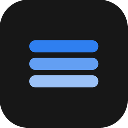
</p>

<h1 align="center">Keel</h1>

<p align="center">Electron + React + TypeScript desktop application framework</p>

<p align="center">
  <a href="README.md">简体中文</a> ·
  <a href="README.en.md">English</a> ·
  <a href="README.ja.md">日本語</a>
</p>

<p align="center">
  
  
  
  
  
  <a href="https://github.com/gqallen931/keel">
    
  </a>
</p>

---

## 1. Scope and Boundaries

### 1.1 What it is

Keel is an engineering skeleton for desktop business applications. It covers four foundation layers:

- **Desktop shell**: frameless window, custom title bar, window controls and system-capability IPC;
- **UI system**: design tokens, Ant Design theme alignment, atomic components and the application shell layout;
- **Data layer**: HTTP client, API wrappers, offline fallback, WebSocket channel;
- **Service layer**: a FastAPI + SQLite REST/WS implementation that can serve as the base of a real backend.

A sample entity (items) demonstrates the full path from API to page. The sample contains no industry rules, real data or
third-party credentials; removing it leaves a blank engineering skeleton.

Repository: https://github.com/gqallen931/keel

### 1.2 Where it fits

- Business systems that need a consistent desktop appearance (title bar, sidebar, main area, optional rail);
- Desktop tools that require a local service, local persistence and offline capability;
- Team projects moving from prototype to deliverable product;
- Organizations that want to reuse one desktop shell and design system across multiple systems.

### 1.3 Non-goals

| Non-goal | Note |
| --- | --- |
| Identity and permissions | No login, RBAC or session management; integrate per product |
| Auto update | electron-updater is intentionally not integrated |
| Multi-window / multi-instance | Single-window, single-instance model; extend as needed |
| Server database | The sample uses a single SQLite file; concurrent multi-instance writes require a server database |
| Media player | Only optional RTSP transcoding (MPEG1-TS); the player and business logic are up to the consumer |

## 2. Capability Matrix

| Capability | Status | Notes |
| --- | --- | --- |
| Frameless window + custom title bar | Built-in | Minimize / maximize / close, double-click maximize, drag region |
| Design tokens and theme | Built-in | CSS variables and AntD ThemeConfig maintained with the same values |
| Atomic components | Built-in | Kpi / Panel / Tag / Seg / Chips / Tabs / Timeline / StatStrip / InfoGrid / RoiCanvas |
| Application shell | Built-in | Title bar + sidebar + main + rail, with wide and narrow window behaviors |
| HTTP data layer | Built-in | axios wrapper, health probe, status-code-based fallback |
| WebSocket channel | Built-in | Auto reconnect, events stored in Zustand |
| CSV / PDF export | Built-in | Browser falls back to print preview |
| SQLite sample service | Built-in | Paginated CRUD, WebSocket broadcast |
| RTSP transcoding | Optional | `src/main/stream`, removable |
| Sample domain (items) | Sample | Removable |

## 3. Architecture

### 3.1 Layers and components

The system consists of three runtime processes/services with fixed boundaries:

| Layer | Main components | Responsibility | Not responsible for |
| --- | --- | --- | --- |
| Main process | `main/index.ts`, `main/ipc.ts`, `main/stream/*` | Window lifecycle, system capabilities, optional streaming | Business rules, persistence |
| Preload | `preload/index.ts`, `shared/bridge.ts` | Whitelisted API via contextBridge | Business logic |
| Renderer | `App`, `router`, `layouts`, `pages`, `components`, `api`, `stores` | Views, interaction, state, API orchestration | Node / filesystem access |
| Local service | `ai-service/app/*` | Persistence, validation, realtime push | UI rendering |

### 3.2 Architecture diagram

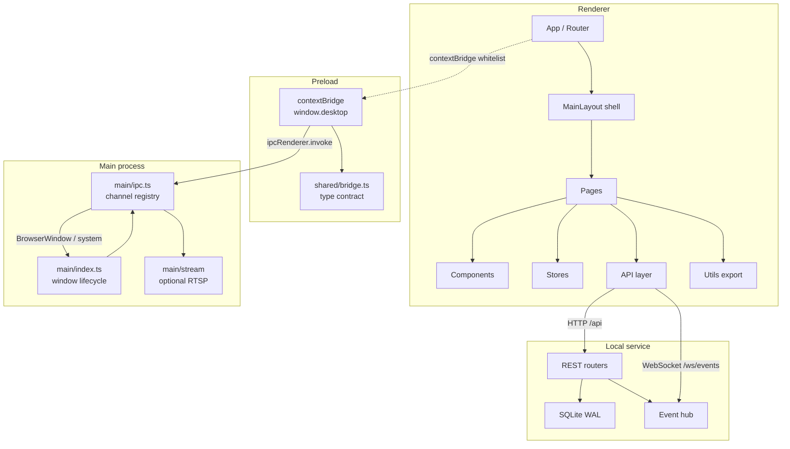

### 3.3 Inter-layer contracts

- **Renderer ↔ main**: only through the four namespaces of `window.desktop` (`win` / `service` / `report` / `stream`);
  channels are named `domain:action` and carry structured-cloneable data.
- **Renderer ↔ local service**: REST under `/api`, realtime events under `/ws/events` with a fixed `AppEvent` shape.
- **Type sources**: cross-process contracts live in `src/shared/bridge.ts`; HTTP contracts mirror between
  frontend `types/index.ts` and backend `schemas.py`.

### 3.4 Startup sequence

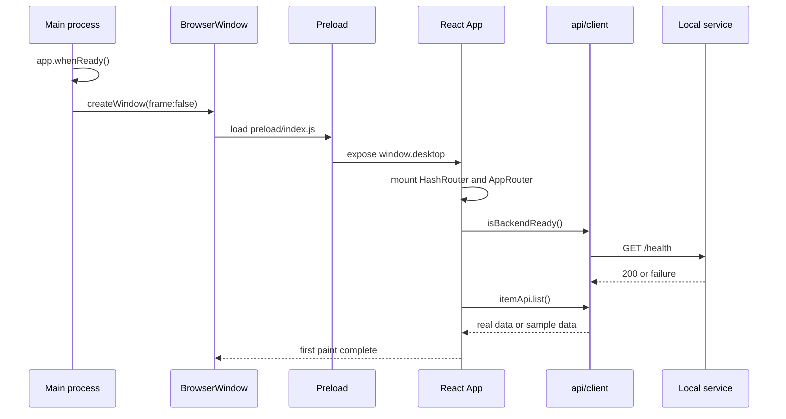

### 3.5 Window control call chain

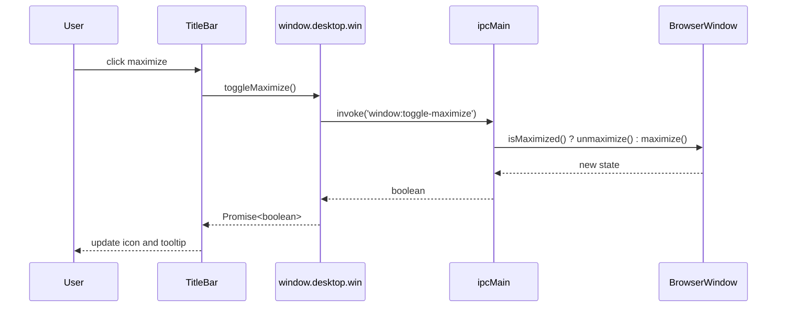

## 4. Key Design Decisions

| Decision | Alternative | Rationale | Impact |
| --- | --- | --- | --- |
| Frameless window + custom title bar | Native title bar | The native bar cannot host branding, page context or status information | Window controls and drag regions must be implemented; already wrapped in `ipc.ts` / `TitleBar.tsx` |
| HashRouter | BrowserRouter | Production loads from `file://` without a server | URLs contain `#`, irrelevant for desktop |
| axios + `withBackend` | React Query / SWR | Keeps caching strategy neutral; fallback semantics in one place | No automatic caching or request deduplication; extend in the `api` layer if needed |
| Zustand | Redux / Context | No provider nesting, fine-grained subscriptions, suitable for event streams | Time-travel debugging requires middleware |
| Dual-source tokens | CSS-in-JS single source | Retains native CSS performance while AntD reuses the same values | New tokens must be added twice; documented in the contribution guide |
| FastAPI + SQLite | A Node-side backend | Easier to integrate algorithms and data processing later; a single file is easy to ship | Concurrent multi-instance writes require another database |
| Bundled sample domain | Blank template | Provides a runnable end-to-end reference and lowers adoption cost | The sample must be removed per checklist before production |

### 4.1 Title bar split into three parts

- **Drag region**: `-webkit-app-region: drag`, double-click maximizes;
- **Interactive region**: all controls declare `no-drag` so the drag region does not swallow clicks;
- **Capability bridge**: `window.desktop.win` exposes four methods; the controls are hidden entirely when the object is absent in browsers.

The split keeps the same UI consistent between Electron and browser dev sessions.

### 4.2 Fallback by status code

```ts
// api/client.ts (excerpt)
if (axios.isAxiosError(e) && (!e.response || e.response.status >= 500)) {
  backendReady = false   // service unavailable: fall back to sample data
  return mock()
}
throw e                  // 4xx is a request error: let the caller handle it
```

Fallback only covers "service not running or unavailable" and never masks parameter or permission errors.
`backendReady` caches the probe result to avoid repeated health checks.

### 4.3 Dual-source design tokens

AntD components read `ThemeConfig`; custom components read CSS variables. The framework keeps both in sync:

- `styles.css :root` defines `--ink`, `--line`, `--r-lg` and related variables;
- `theme.ts tokens` maps the same values in camelCase and distributes them via `appTheme`;
- ECharts reuses the same color set through the `chart` object.

Changing the brand color updates tables, buttons, charts and custom cards together.

### 4.4 Packaging size control

`electron-builder` copies `dependencies` into `app.asar`. Renderer dependencies (react / antd / echarts and others) are already
bundled by Vite into `out/renderer`, so they live in `devDependencies`; `dependencies` keeps only `ws` and `ffmpeg-static`,
which the main process actually `require`s. With `files: [out/**, package.json]`, the installer contains only runtime files.

## 5. Data Flow and Call Chains

### 5.1 List query

```mermaid
sequenceDiagram
  participant Page as Page
  participant Api as api/index.ts
  participant Client as api/client.ts
  participant Srv as Local service
  Page->>Api: itemApi.list({ page, keyword })
  Api->>Client: withBackend(real, mock)
  alt service available
    Client->>Srv: GET /api/items
    Srv-->>Client: 200 ItemPage
    Client-->>Api: real data
  else service down or 5xx
    Client-->>Api: sample data from mock/demo.ts
  end
  Api-->>Page: ItemPage
  Note over Client: 4xx is not degraded; errors propagate
```

### 5.2 Realtime events

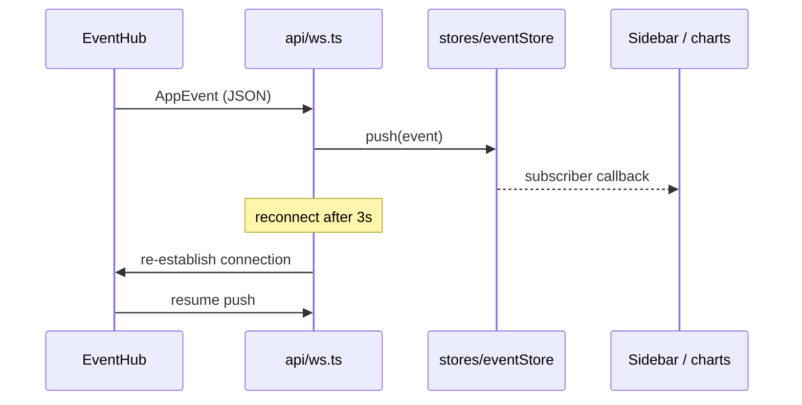

### 5.3 PDF export

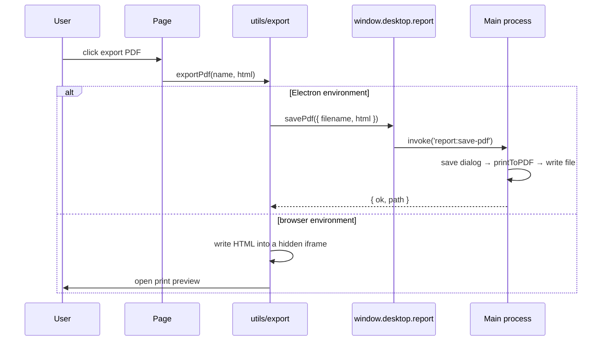

## 6. Modules and Dependency Rules

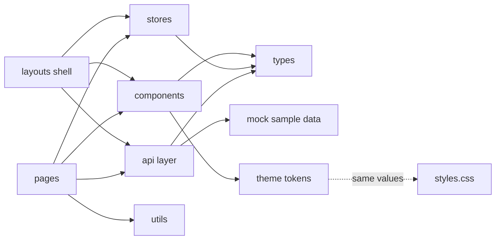

Dependencies are one-directional:

1. `pages` may depend on `components` / `api` / `stores` / `utils`;
2. `components` depend only on `types` and `theme` and never issue network requests;
3. Pages never use `axios` directly; all requests go through the `api` layer, centralizing fallback and future auth hooks.

## 7. Trimmable Design

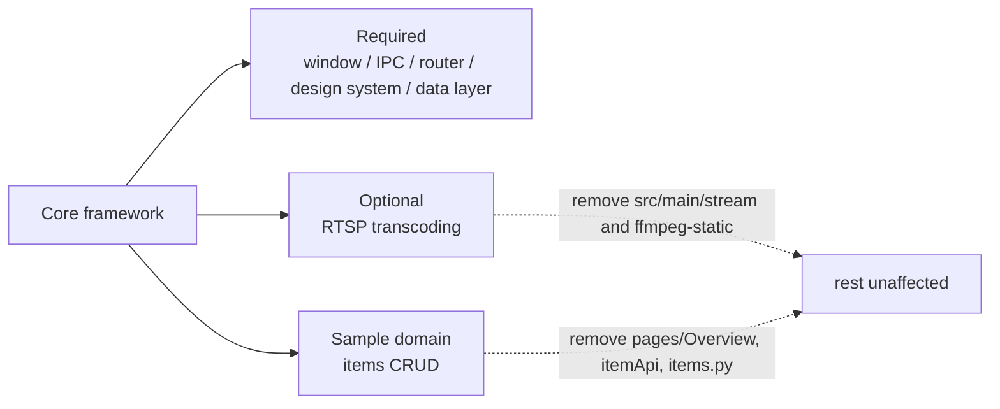

## 8. Technology Choices

| Tech | Rationale |
| --- | --- |
| Electron 31 | Complete desktop capabilities (window / print / tray / protocol); the main process can safely host Node |
| React 18 + TypeScript | Mature component model and type inference; contract errors surface at compile time |
| electron-vite (Vite 5) | One configuration for main / preload / renderer; layered output under `out/` |
| Ant Design 5 | Complete enterprise components; ThemeConfig aligns with custom tokens |
| ECharts 5 | Broad chart coverage; themes reuse the same color set |
| Zustand | Lightweight, provider-free; suits event streams and cross-page state |
| FastAPI + Pydantic | Contracts as code with generated OpenAPI; maps one-to-one with frontend TS types |
| SQLite (WAL) | Single file, zero deployment, friendly concurrent reads; fits desktop |

## 9. Project Structure

```
.
├── electron.vite.config.ts      # main / preload / renderer build (with dev proxy)
├── vite.web.config.ts           # browser-only dev server (renderer only)
├── electron-builder.yml         # Windows packaging (nsis + portable)
├── build/icon.ico               # application icon
├── docs/
│   ├── API.md                   # IPC / HTTP / WS / frontend module contracts
│   ├── ARCHITECTURE.md          # layering, dependency rules, security baseline
│   └── images/                  # README screenshots and logo
├── src/
│   ├── main/                    # main process
│   │   ├── index.ts             # window creation, lifecycle, stream server
│   │   ├── ipc.ts               # window / service / report / stream channels
│   │   └── stream/              # optional: RTSP → MPEG1-TS
│   ├── preload/                 # contextBridge implementation and global types
│   ├── shared/                  # cross-process type contract (no electron dependency)
│   └── renderer/src/
│       ├── router/              # route table
│       ├── layouts/             # title bar + sidebar + main + rail
│       ├── components/          # TitleBar / UI atoms / Tag / RoiCanvas
│       ├── pages/               # Overview / Components / Settings
│       ├── api/                 # client / ws / API set
│       ├── stores/              # Zustand
│       ├── mock/                # sample data
│       ├── types/               # shared types
│       ├── utils/               # CSV / PDF export
│       ├── theme.ts             # theme and tokens
│       └── styles.css           # design system
└── ai-service/                  # FastAPI + SQLite sample service
    ├── run.py
    ├── configs/settings.yaml
    └── app/                     # main / config / db / schemas / api / ws
```

## 10. Screenshots

Screenshots are taken from the running application (1440×900, sample data).

### 10.1 Overview

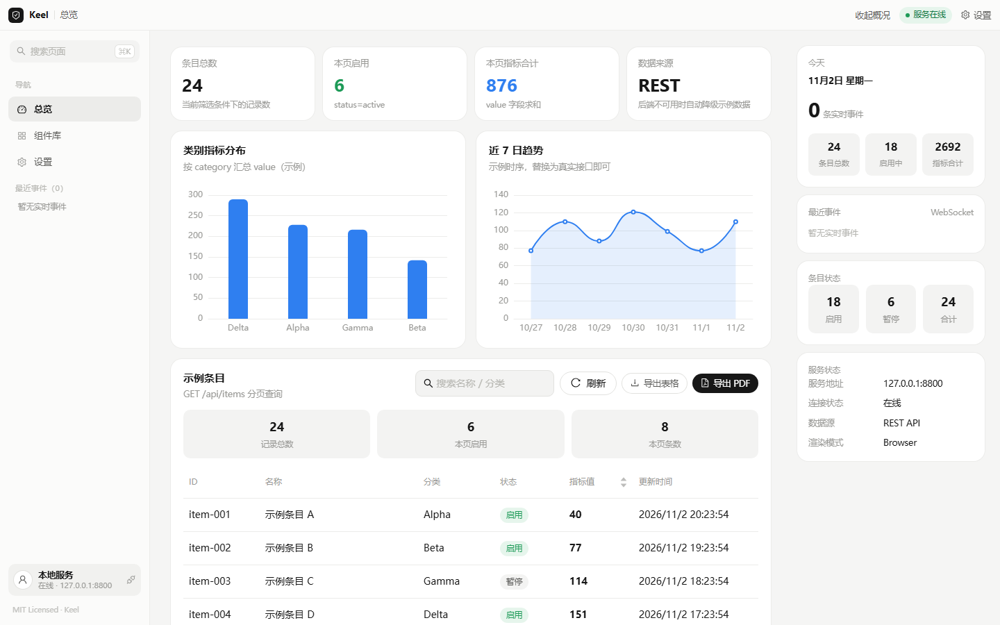

### 10.2 Component library

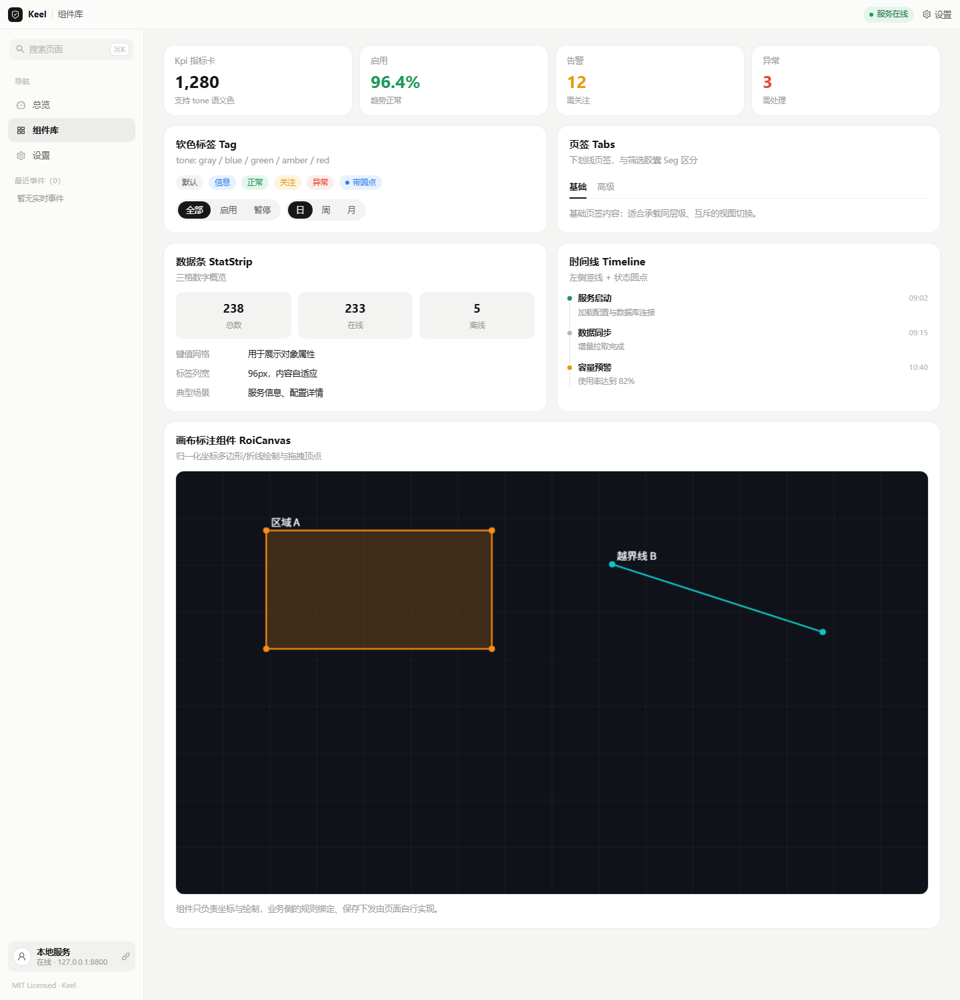

### 10.3 Settings

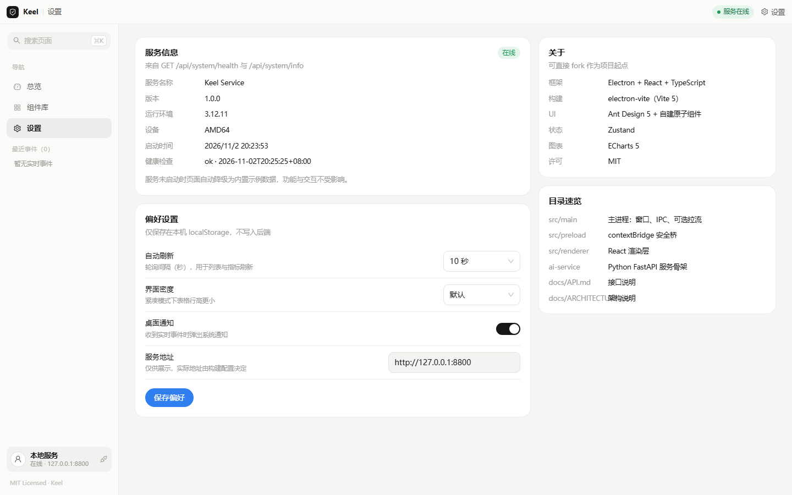

### 10.4 Interaction states

| Keyword filtering | Collapsed summary rail |
| --- | --- |
| 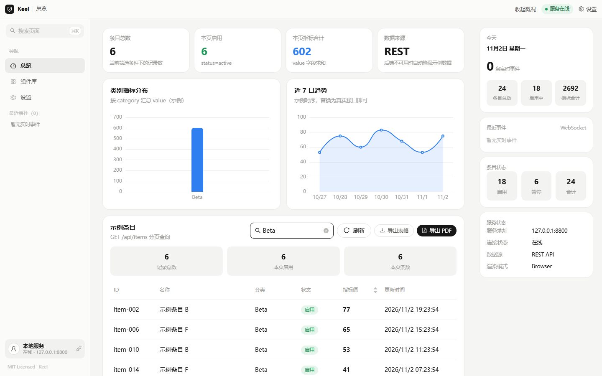 | 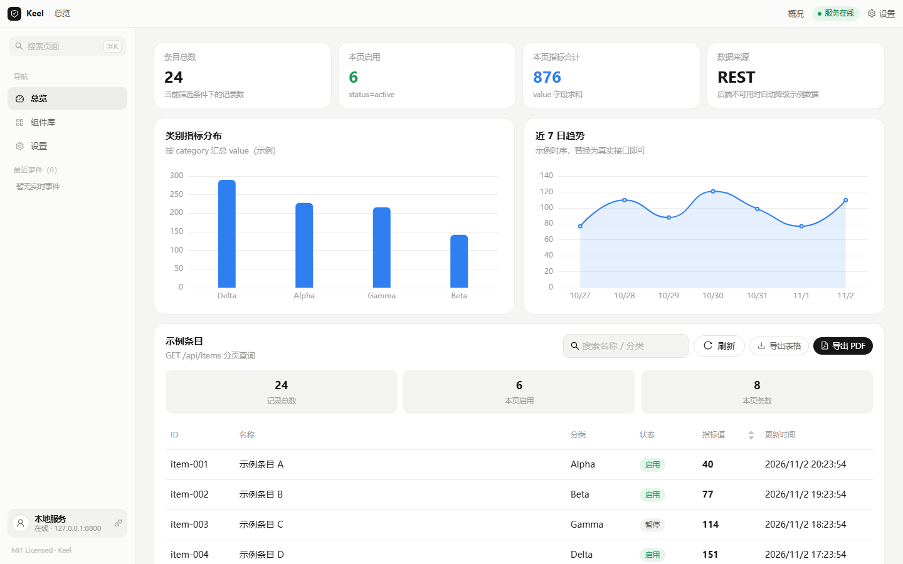 |
| **Pagination** | **Component library interactions** |
| 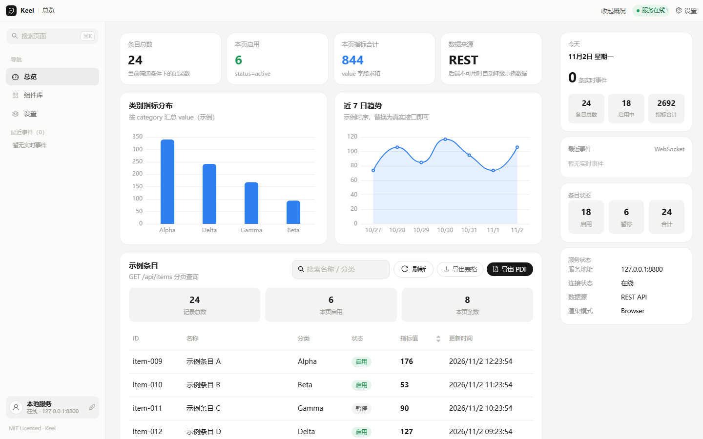 | 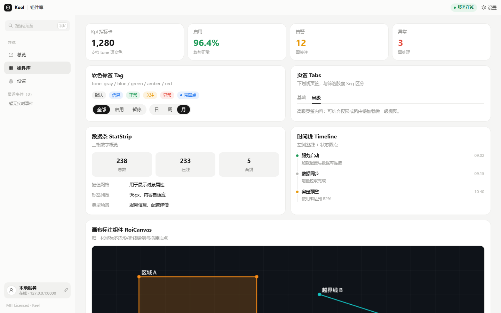 |
| **Global search (⌘K)** | **Preferences** |
| 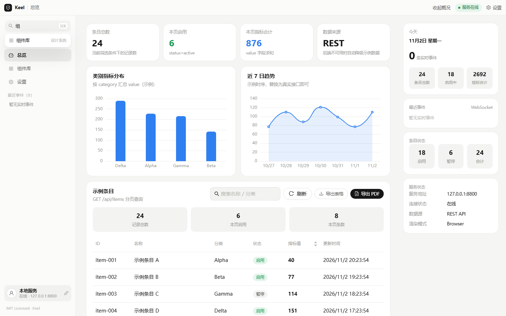 | 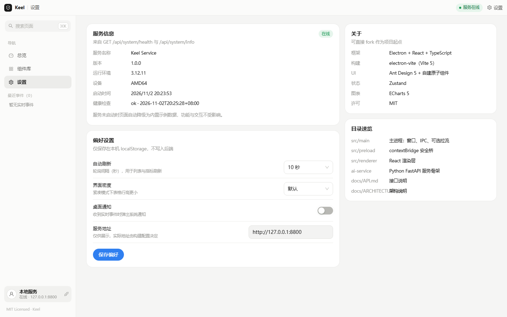 |

## 11. Quick Start

### 11.1 Requirements

- Node.js ≥ 18 (20 LTS recommended)
- npm ≥ 9 (or pnpm / yarn)
- Python ≥ 3.10 (local service only)

### 11.2 Install and run

```bash
# clone the repository
git clone git@github.com:gqallen931/keel.git
cd keel

# install frontend dependencies
npm install

# install and start the local service (optional; the UI uses sample data without it)
cd ai-service
pip install -r requirements.txt
python run.py            # http://127.0.0.1:8800

# start the desktop app in dev mode
cd ..
npm run dev
```

### 11.3 Commands

| Command | Purpose |
| --- | --- |
| `npm run dev` | Electron dev mode (main + renderer hot reload) |
| `npm run dev:web` | Browser-only dev server (http://localhost:5180) |
| `npm run build` | Build into `out/` |
| `npm start` | Preview the build output |
| `npm run typecheck` | Type-check renderer and main process |
| `npm run dist:win` | Package Windows installer and portable build into `release/` |

## 12. Quality and Verification

| Item | Rule |
| --- | --- |
| Type checking | Two project configs (web / node) with `strict`, `isolatedModules`, `useDefineForClassFields`, `noFallthroughCasesInSwitch` |
| Cross-process types | Contracts live in `src/shared/bridge.ts`; the renderer never imports Electron implementations |
| Incremental cache | `tsBuildInfoFile` points to `node_modules/.cache`, keeping the repository clean |
| Build | `electron-vite build` emits `out/main`, `out/preload`, `out/renderer` |
| Packaging | `electron-builder` emits an NSIS installer and a portable build |

```bash
npm run typecheck   # tsc --noEmit -p tsconfig.web.json && tsc --noEmit -p tsconfig.node.json
npm run build
```

## 13. API Usage

See [docs/API.md](docs/API.md) for the full contract. Summary:

```ts
import { itemApi, systemApi } from '@/api'

const page = await itemApi.list({ page: 1, page_size: 10, keyword: 'demo' })
const created = await itemApi.create({ name: 'New item', category: 'Alpha', status: 'active', value: 10 })
await itemApi.update(created.id, { value: 20 })
await itemApi.remove(created.id)
const health = await systemApi.health()
```

Realtime events and main-process capabilities:

```ts
import { eventStream } from '@/api/ws'
import { useEventStore } from '@/stores/eventStore'

eventStream.connect()
const off = eventStream.subscribe((event) => useEventStore.getState().push(event))

await window.desktop.win.toggleMaximize()
await window.desktop.report.savePdf({ filename: 'report', html })
```

## 14. Development Guide

### 14.1 Add a page

1. Create the component at `src/renderer/src/pages/YourPage/index.tsx`;
2. Register the route in `router/index.tsx`;
3. Add a navigation item to `NAV_ITEMS` and a title to `ROUTE_META` in `layouts/MainLayout.tsx`.

### 14.2 Connect business APIs

1. Define entity and pagination types in `types/index.ts`;
2. Add `xxxApi` in `api/index.ts` (reuse `withBackend` to keep the fallback);
3. Define Pydantic models in `ai-service/app/schemas.py` and add routers under `api/`;
4. For realtime push, call `hub.broadcast_threadsafe(...)` in `app/ws/events.py`.

### 14.3 Remove the sample

- Delete `mock/demo.ts`;
- Remove the mock branch of `withBackend` in `api/index.ts`;
- Delete `pages/Overview`, `ai-service/app/api/items.py` and its router registration.

### 14.4 Design tokens

Update both the `:root` variables in `src/renderer/src/styles.css` and `tokens` / `appTheme` in `src/renderer/src/theme.ts`.

### 14.5 Add an IPC channel

Register in `src/main/ipc.ts` → define the contract in `src/shared/bridge.ts` → implement in `src/preload/index.ts` → use in the renderer.

## 15. Contributing

See [CONTRIBUTING.md](CONTRIBUTING.md). `npm run typecheck` must pass before committing; use Conventional Commits;
never commit `node_modules`, `out`, `release` or `runtime`.

## 16. License

[MIT License](LICENSE).

## 17. FAQ

| Question | Answer |
| --- | --- |
| The page shows "service offline" | The local service is not running; start `ai-service/run.py` or keep using sample data |
| Port conflict | Change `port` in `ai-service/configs/settings.yaml` and update both vite proxy targets |
| Download failures while packaging | Configure the `ELECTRON_MIRROR` and `ELECTRON_BUILDER_BINARIES_MIRROR` mirrors |
| RTSP is not needed | Remove `src/main/stream/`, the stream channels, the preload `stream` bridge and `ffmpeg-static` |
| Need in-app i18n | Add an i18n library, centralize messages under `locales/`, and read them from the title bar and nav |
