<p align="center">
  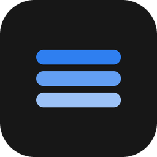
</p>

<h1 align="center">Keel</h1>

<p align="center">Electron + React + TypeScript デスクトップアプリケーションフレームワーク</p>

<p align="center">
  <a href="README.md">简体中文</a> ·
  <a href="README.en.md">English</a> ·
  <a href="README.ja.md">日本語</a>
</p>

<p align="center">
  
  
  
  
  
  <a href="https://github.com/gqallen931/keel">
    
  </a>
</p>

---

## 1. 適用範囲と境界

### 1.1 概要

Keel はデスクトップ業務システム向けのエンジニアリング骨格で、次の 4 層を提供します。

- **デスクトップシェル**：フレームレスウィンドウ、自前タイトルバー、ウィンドウ制御とシステム機能の IPC；
- **UI 体系**：デザイントークン、Ant Design テーマ整合、原子コンポーネントとアプリシェル；
- **データ層**：HTTP クライアント、API ラッパー、オフラインフォールバック、WebSocket 経路；
- **サービス層**：FastAPI + SQLite による REST/WS 実装（実バックエンドの起点として利用可能）。

サンプルエンティティ（items）で API から画面までの一連の流れを示します。サンプルには業界固有のルール、
実データ、第三者認証情報は含まれず、削除すれば空の骨格になります。

リポジトリ：https://github.com/gqallen931/keel

### 1.2 適用シーン

- 統一されたデスクトップ外観（タイトルバー、サイドバー、メイン、任意のレール）が必要な業務システム；
- ローカルサービス、ローカル永続化、オフライン動作が必要なデスクトップツール；
- プロトタイプから納品可能な製品へ移行するチームプロジェクト；
- 複数システムで同一のデスクトップシェルとデザインシステムを再利用したい組織。

### 1.3 非目標

| 非目標 | 説明 |
| --- | --- |
| 認証・権限 | ログイン、RBAC、セッション管理は含まず、製品側で実装 |
| 自動更新 | electron-updater は意図的に未導入 |
| マルチウィンドウ / 多重起動 | 単一ウィンドウ・単一インスタンス。必要に応じて拡張 |
| サーバー DB | サンプルは SQLite 単一ファイル。多重書き込みにはサーバー DB が必要 |
| メディアプレイヤー | 任意の RTSP 変換（MPEG1-TS）のみ。プレイヤーと業務ロジックは利用側で実装 |

## 2. 機能一覧

| 機能 | 状態 | 説明 |
| --- | --- | --- |
| フレームレス + 自前タイトルバー | 標準 | 最小化 / 最大化 / 終了、ダブルクリック最大化、ドラッグ領域 |
| デザイントークンとテーマ | 標準 | CSS 変数と AntD ThemeConfig を同値で維持 |
| 原子コンポーネント | 標準 | Kpi / Panel / Tag / Seg / Chips / Tabs / Timeline / StatStrip / InfoGrid / RoiCanvas |
| アプリシェル | 標準 | タイトルバー + サイドバー + メイン + レール、広い/狭い画面で 2 形態 |
| HTTP データ層 | 標準 | axios ラッパー、ヘルス検知、ステータス碼によるフォールバック |
| WebSocket 経路 | 標準 | 自動再接続、イベントを store に集約 |
| CSV / PDF 出力 | 標準 | ブラウザでは印刷プレビューにフォールバック |
| SQLite サンプルサービス | 標準 | ページング CRUD、WebSocket 配信 |
| RTSP 変換配信 | 任意 | `src/main/stream`、まとめて削除可能 |
| サンプルドメイン（items） | サンプル | 削除可能 |

## 3. アーキテクチャ

### 3.1 レイヤーとコンポーネント

3 つの実行プロセス/サービスで構成され、境界は固定です。

| 層 | 主要コンポーネント | 責務 | 担当しないこと |
| --- | --- | --- | --- |
| メインプロセス | `main/index.ts`、`main/ipc.ts`、`main/stream/*` | ウィンドウライフサイクル、システム機能、任意の配信 | 業務ルール、永続化 |
| プリロード | `preload/index.ts`、`shared/bridge.ts` | contextBridge によるホワイトリスト API | 業務ロジック |
| レンダラー | `App`、`router`、`layouts`、`pages`、`components`、`api`、`stores` | 表示、操作、状態、API 編成 | Node / ファイルシステムへのアクセス |
| ローカルサービス | `ai-service/app/*` | 永続化、検証、リアルタイム配信 | 画面描画 |

### 3.2 アーキテクチャ図

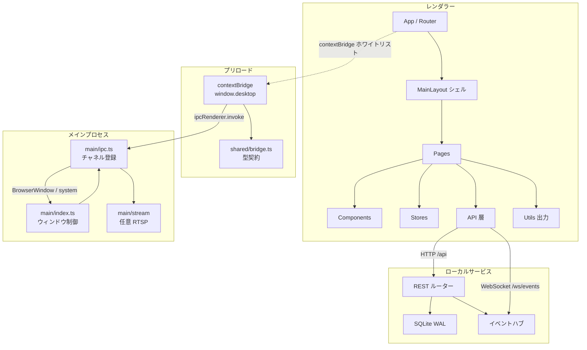

### 3.3 層間の契約

- **レンダラー ↔ メイン**：`window.desktop` の 4 名前空間（`win` / `service` / `report` / `stream`）のみ。
  チャネル名は `domain:action`、引数と戻り値は構造化クローン可能なデータ。
- **レンダラー ↔ ローカルサービス**：REST は `/api`、リアルタイムは `/ws/events`、イベント構造は `AppEvent` 固定。
- **型の出所**：プロセス間の契約は `src/shared/bridge.ts`、HTTP 契約はフロントの `types/index.ts` と
  バックエンドの `schemas.py` が一対一で対応。

### 3.4 起動シーケンス

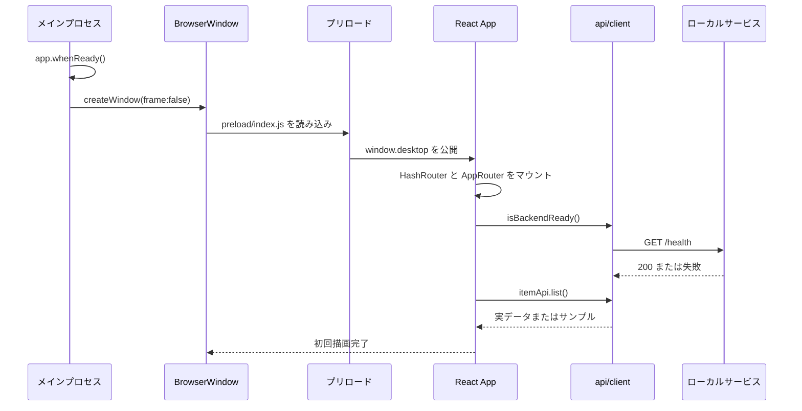

### 3.5 ウィンドウ制御の呼び出し経路

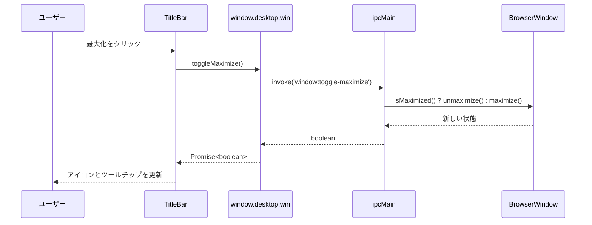

## 4. 主要な設計判断

| 判断 | 代替案 | 根拠 | 影響 |
| --- | --- | --- | --- |
| フレームレス + 自前タイトルバー | 標準タイトルバー | 標準バーはブランド、ページ情報、状態を表示できない | ウィンドウ制御とドラッグ領域の実装が必要（`ipc.ts` / `TitleBar.tsx` に集約済み） |
| HashRouter | BrowserRouter | 本番は `file://` でサーバー無し | URL に `#` が入る（デスクトップでは問題なし） |
| axios + `withBackend` | React Query / SWR | キャッシュ戦略を固定せず、フォールバック意味論を 1 箇所に集約 | 自動キャッシュ・重複排除なし。必要なら `api` 層で拡張 |
| Zustand | Redux / Context | Provider 不要、購読粒度が細かい | タイムトラベルデバッグにはミドルウェアが必要 |
| トークン二重管理 | CSS-in-JS 単一ソース | ネイティブ CSS の性能を保ちつつ AntD が同じ値を使用 | 新規トークンは 2 箇所修正（貢献ガイドに明記） |
| FastAPI + SQLite | Node 側バックエンド | 将来のアルゴリズム/データ処理に有利。単一ファイルで配布容易 | 多重書き込みには別 DB が必要 |
| サンプルドメイン同梱 | 空テンプレート | 動作する E2E 参考を提供し導入学習コストを低減 | 本番前にチェックリスト通り削除が必要 |

### 4.1 タイトルバーを 3 分割する

- **ドラッグ領域**：`-webkit-app-region: drag`、ダブルクリックで最大化；
- **操作領域**：すべてのコントロールが `no-drag` を宣言し、クリックが飲み込まれない；
- **機能ブリッジ**：`window.desktop.win` が 4 メソッドを公開。ブラウザではオブジェクトが無いため全体を非表示。

この分割により、Electron とブラウザ開発で同じ UI が同じ挙動になります。

### 4.2 ステータス碼によるフォールバック

```ts
// api/client.ts（抜粋）
if (axios.isAxiosError(e) && (!e.response || e.response.status >= 500)) {
  backendReady = false   // サービス不能：サンプルデータへ
  return mock()
}
throw e                  // 4xx はリクエストの誤り：呼び出し側で処理
```

フォールバックは「サービス未起動・利用不能」のみを対象とし、パラメータや権限の誤りを隠しません。
`backendReady` は検知結果をキャッシュし、ヘルスチェックの重複を避けます。

### 4.3 デザイントークンの二重管理

AntD は `ThemeConfig`、自作コンポーネントは CSS 変数を読みます。フレームワークは両者を同値に保ちます。

- `styles.css :root` に `--ink`、`--line`、`--r-lg` などを定義；
- `theme.ts tokens` に同じ値をキャメルケースで定義し、`appTheme` から配布；
- ECharts は `chart` オブジェクトで同じ色を再利用。

ブランドカラーを変更すると、テーブル、ボタン、チャート、自作カードが同時に更新されます。

### 4.4 パッケージサイズの制御

`electron-builder` は `dependencies` を `app.asar` にコピーします。react / antd / echarts などのレンダラー依存は
Vite が `out/renderer` にバンドル済みのため `devDependencies` に置き、`dependencies` にはメインプロセスが実際に
`require` する `ws` と `ffmpeg-static` のみを残します。`files: [out/**, package.json]` と組み合わせ、
インストーラーには実行時に必要なファイルだけが含まれます。

## 5. データフローと呼び出し経路

### 5.1 一覧クエリ

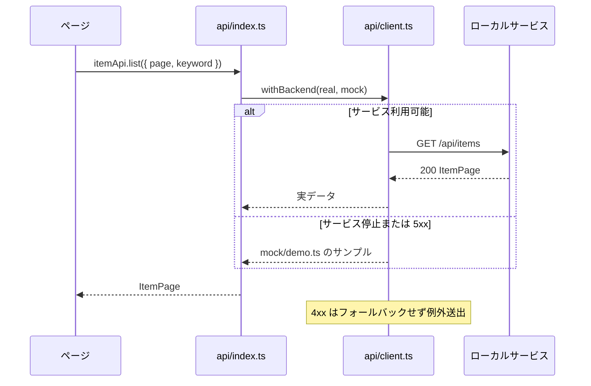

### 5.2 リアルタイムイベント

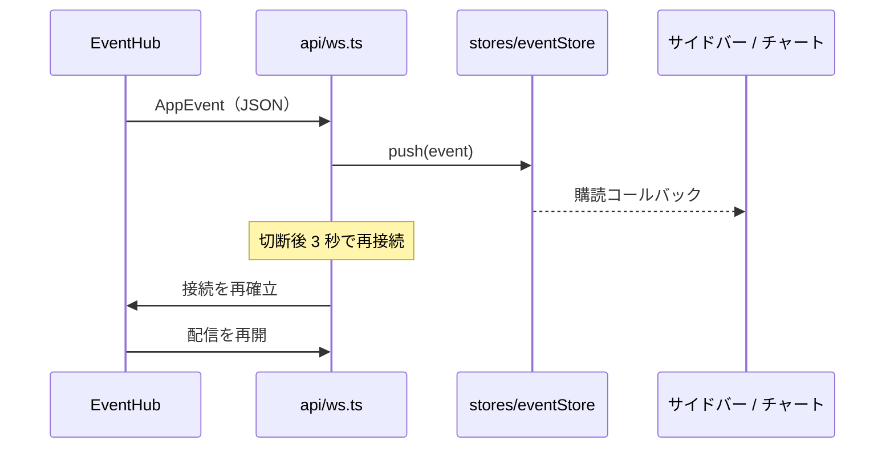

### 5.3 PDF 出力

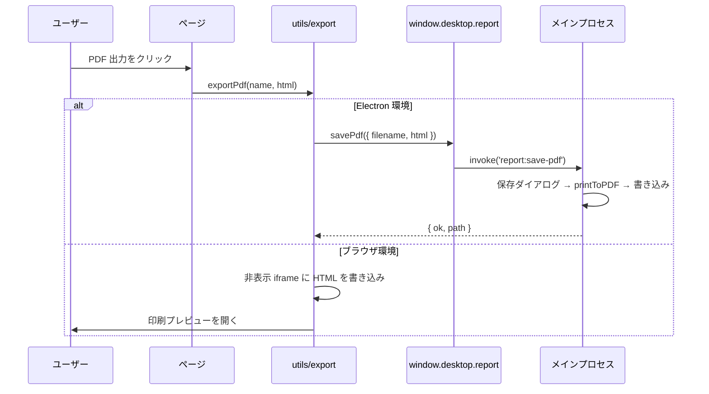

## 6. モジュールと依存ルール

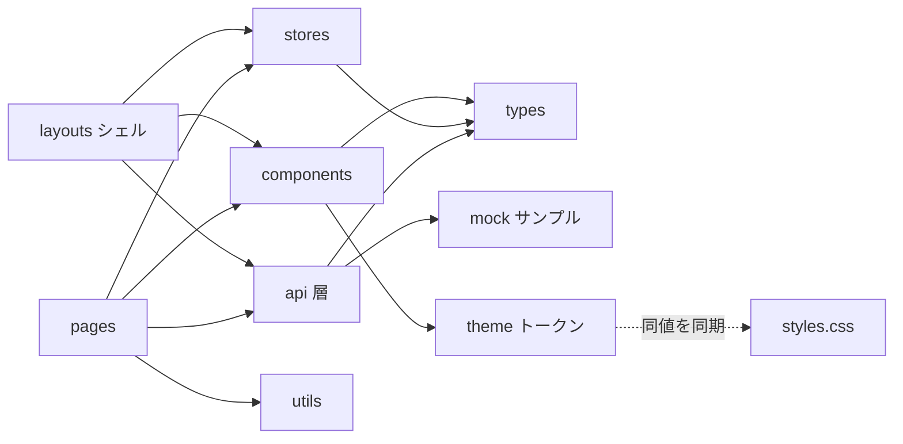

依存方向は一方向です。

1. `pages` は `components` / `api` / `stores` / `utils` に依存可能；
2. `components` は `types` と `theme` のみに依存し、ネットワーク要求を発行しない；
3. ページは `axios` を直接使わず、必ず `api` 層を経由する（フォールバックと将来の認証拡張点を集約）。

## 7. 削除可能な設計

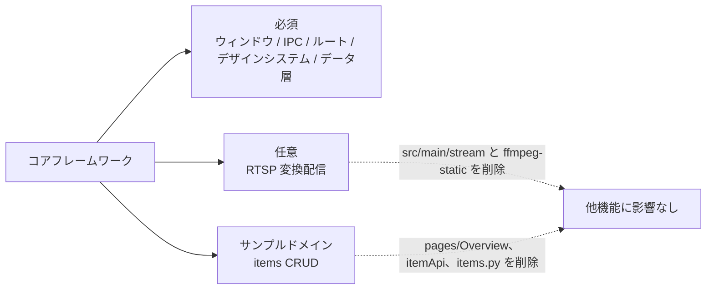

## 8. 技術選定

| 技術 | 選定根拠 |
| --- | --- |
| Electron 31 | デスクトップ機能が揃う（ウィンドウ / 印刷 / トレイ / プロトコル）。メインで Node を安全に利用可能 |
| React 18 + TypeScript | コンポーネントモデルと型推論が成熟。契約の不整合をコンパイル時に検出 |
| electron-vite（Vite 5） | main / preload / renderer を 1 設定で管理し、`out/` に層別出力 |
| Ant Design 5 | 業務向けコンポーネントが充実。ThemeConfig を自作トークンと整合可能 |
| ECharts 5 | チャート種別が豊富で、同一色セットによるテーマ統一が可能 |
| Zustand | 軽量・Provider 不要。イベント流とページ横断状態に適合 |
| FastAPI + Pydantic | 契約がコードになり OpenAPI を生成。フロントの TS 型と一対一対応 |
| SQLite（WAL） | 単一ファイル・導入不要・同時読み取りに強く、デスクトップ単機に適合 |

## 9. ディレクトリ構成

```
.
├── electron.vite.config.ts      # main / preload / renderer ビルド（dev プロキシ含む）
├── vite.web.config.ts           # ブラウザのみの開発サーバー
├── electron-builder.yml         # Windows パッケージ（nsis + portable）
├── build/icon.ico               # アプリアイコン
├── docs/
│   ├── API.md                   # IPC / HTTP / WS / フロントモジュール契約
│   ├── ARCHITECTURE.md          # レイヤー、依存ルール、セキュリティ基準
│   └── images/                  # README 用スクリーンショットとロゴ
├── src/
│   ├── main/                    # メインプロセス
│   │   ├── index.ts             # ウィンドウ生成、ライフサイクル、配信サーバー
│   │   ├── ipc.ts               # window / service / report / stream チャネル
│   │   └── stream/              # 任意：RTSP → MPEG1-TS
│   ├── preload/                 # contextBridge 実装とグローバル型
│   ├── shared/                  # プロセス間の型契約（electron 非依存）
│   └── renderer/src/
│       ├── router/              # ルート定義
│       ├── layouts/             # タイトルバー + サイドバー + メイン + レール
│       ├── components/          # TitleBar / UI 原子 / Tag / RoiCanvas
│       ├── pages/               # Overview / Components / Settings
│       ├── api/                 # client / ws / API 集約
│       ├── stores/              # Zustand
│       ├── mock/                # サンプルデータ
│       ├── types/               # 共通型
│       ├── utils/               # CSV / PDF 出力
│       ├── theme.ts             # テーマとトークン
│       └── styles.css           # デザインシステム
└── ai-service/                  # FastAPI + SQLite サンプルサービス
    ├── run.py
    ├── configs/settings.yaml
    └── app/                     # main / config / db / schemas / api / ws
```

## 10. 画面プレビュー

いずれも実際に動作している画面です（1440×900、サンプルデータ）。

### 10.1 概要ページ

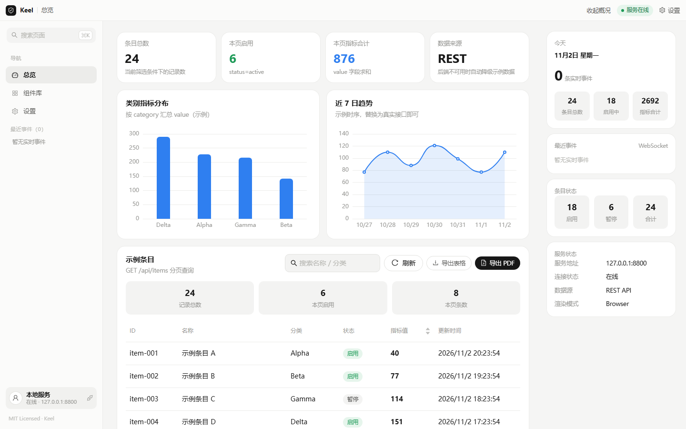

### 10.2 コンポーネントライブラリ

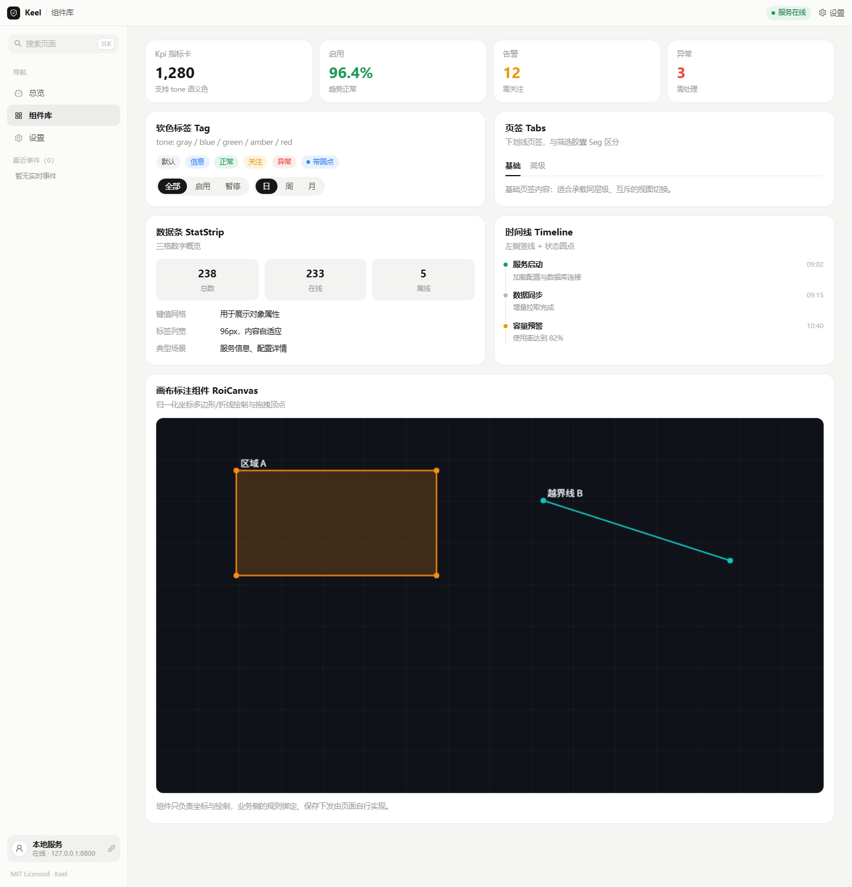

### 10.3 設定ページ

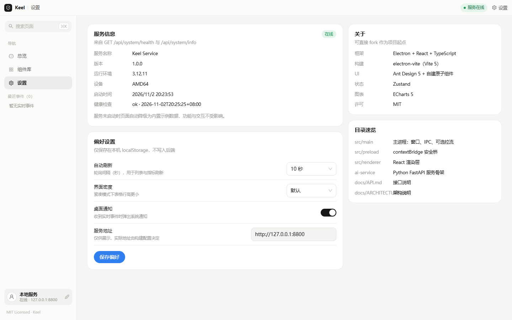

### 10.4 操作状態

| キーワード絞り込み | レール収納 |
| --- | --- |
| 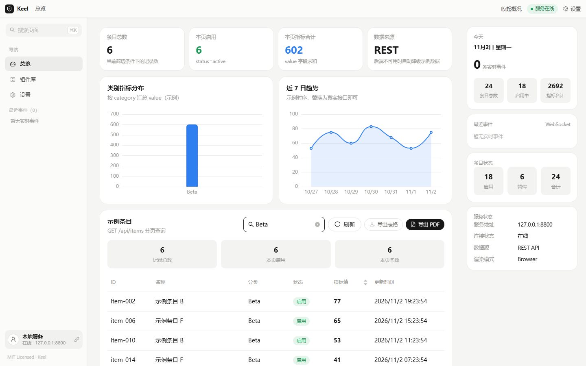 | 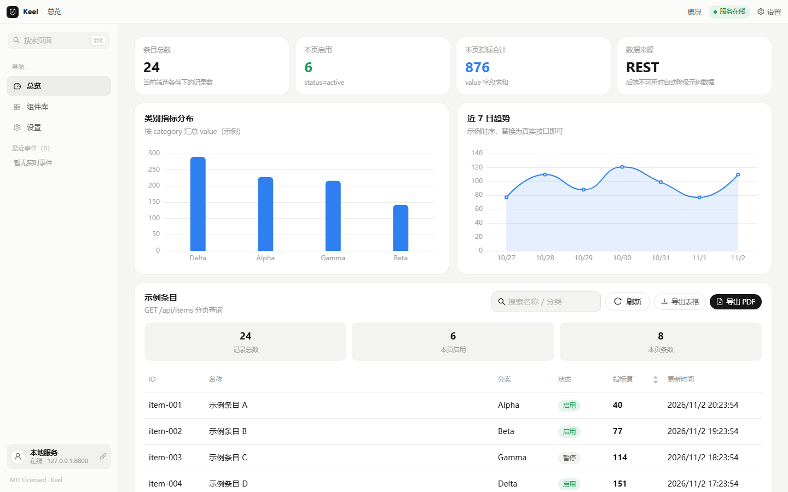 |
| **ページング** | **コンポーネント操作** |
| 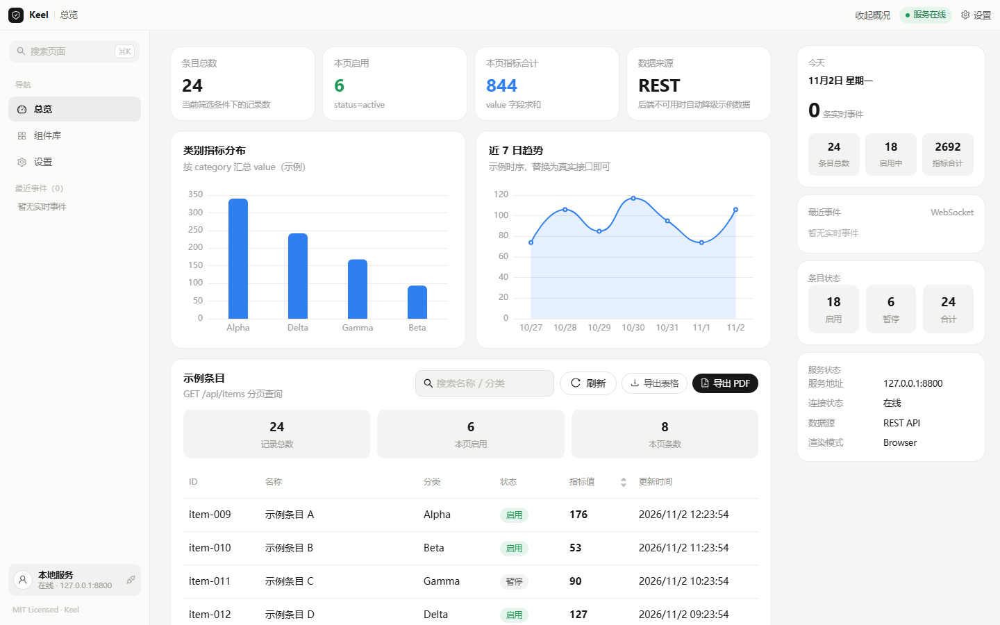 | 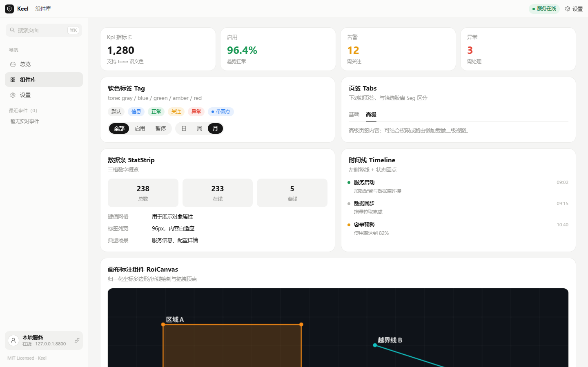 |
| **グローバル検索（⌘K）** | **ローカル設定** |
| 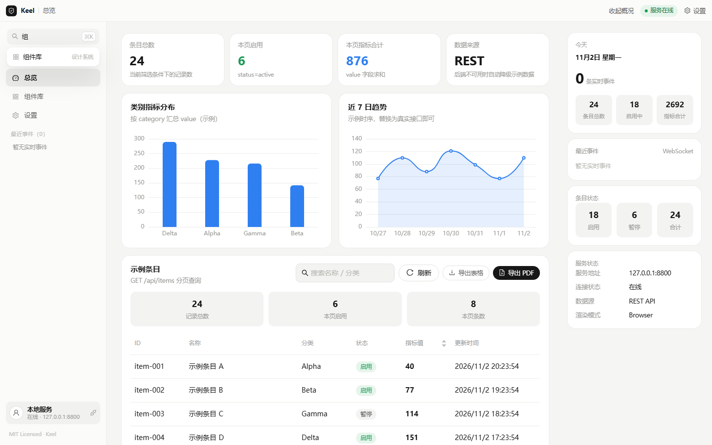 | 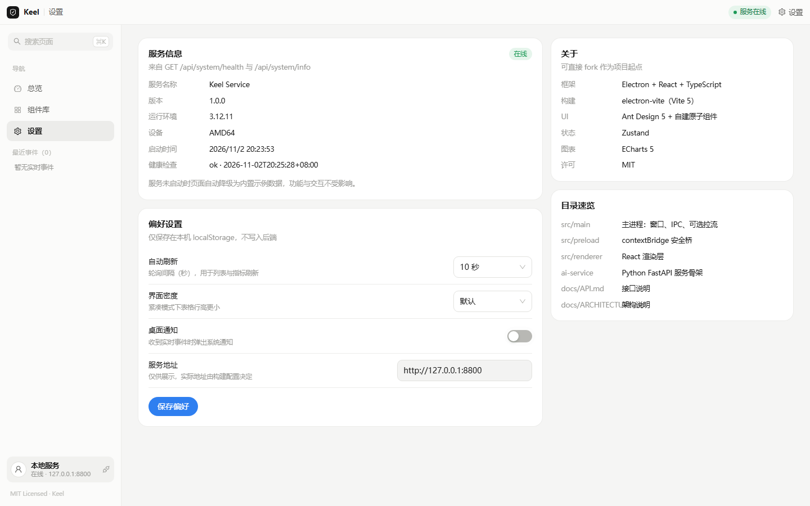 |

## 11. クイックスタート

### 11.1 動作環境

- Node.js ≥ 18（20 LTS 推奨）
- npm ≥ 9（pnpm / yarn でも可）
- Python ≥ 3.10（ローカルサービスのみ）

### 11.2 インストールと起動

```bash
# リポジトリをクローン
git clone git@github.com:gqallen931/keel.git
cd keel

# フロントエンド依存関係をインストール
npm install

# ローカルサービスをインストールして起動（任意。未起動時はサンプルデータ）
cd ai-service
pip install -r requirements.txt
python run.py            # http://127.0.0.1:8800

# デスクトップアプリを開発モードで起動
cd ..
npm run dev
```

### 11.3 コマンド

| コマンド | 用途 |
| --- | --- |
| `npm run dev` | Electron 開発モード（main + renderer ホットリロード） |
| `npm run dev:web` | ブラウザのみの開発サーバー（http://localhost:5180） |
| `npm run build` | `out/` にビルド |
| `npm start` | ビルド成果物をプレビュー |
| `npm run typecheck` | レンダラーとメインプロセスの型チェック |
| `npm run dist:win` | Windows インストーラーとポータブル版を `release/` に出力 |

## 12. 品質と検証

| 項目 | ルール |
| --- | --- |
| 型チェック | web / node の 2 設定で `strict`、`isolatedModules`、`useDefineForClassFields`、`noFallthroughCasesInSwitch` を有効化 |
| プロセス間型 | 契約は `src/shared/bridge.ts` に集約し、レンダラーは Electron 実装を参照しない |
| 増分キャッシュ | `tsBuildInfoFile` を `node_modules/.cache` に置き、リポジトリを汚さない |
| ビルド | `electron-vite build` が `out/main`、`out/preload`、`out/renderer` を出力 |
| パッケージ | `electron-builder` が NSIS インストーラーと portable 版を出力 |

```bash
npm run typecheck   # tsc --noEmit -p tsconfig.web.json && tsc --noEmit -p tsconfig.node.json
npm run build
```

## 13. API の使い方

完全な契約は [docs/API.md](docs/API.md) を参照。概要：

```ts
import { itemApi, systemApi } from '@/api'

const page = await itemApi.list({ page: 1, page_size: 10, keyword: 'demo' })
const created = await itemApi.create({ name: 'New item', category: 'Alpha', status: 'active', value: 10 })
await itemApi.update(created.id, { value: 20 })
await itemApi.remove(created.id)
const health = await systemApi.health()
```

リアルタイムイベントとメインプロセス機能：

```ts
import { eventStream } from '@/api/ws'
import { useEventStore } from '@/stores/eventStore'

eventStream.connect()
const off = eventStream.subscribe((event) => useEventStore.getState().push(event))

await window.desktop.win.toggleMaximize()
await window.desktop.report.savePdf({ filename: 'report', html })
```

## 14. 二次開発

### 14.1 ページ追加

1. `src/renderer/src/pages/YourPage/index.tsx` にコンポーネントを作成；
2. `router/index.tsx` にルートを登録；
3. `layouts/MainLayout.tsx` の `NAV_ITEMS` に項目、`ROUTE_META` にタイトルを追加。

### 14.2 業務 API の接続

1. `types/index.ts` にエンティティとページング型を定義；
2. `api/index.ts` に `xxxApi` を追加（`withBackend` を再利用）；
3. `ai-service/app/schemas.py` に Pydantic モデルを定義し、`api/` にルーターを追加；
4. リアルタイム配信は `app/ws/events.py` の `hub.broadcast_threadsafe(...)` を呼び出す。

### 14.3 サンプルの削除

- `mock/demo.ts` を削除；
- `api/index.ts` の `withBackend` から mock 分岐を削除；
- `pages/Overview`、`ai-service/app/api/items.py` とルート登録を削除。

### 14.4 デザイントークン

`src/renderer/src/styles.css` の `:root` と `src/renderer/src/theme.ts` の `tokens` / `appTheme` を両方変更します。

### 14.5 IPC の追加

`src/main/ipc.ts` で登録 → `src/shared/bridge.ts` で契約定義 → `src/preload/index.ts` で実装 → レンダラーから利用。

## 15. コントリビュート

[CONTRIBUTING.md](CONTRIBUTING.md) を参照。コミット前に `npm run typecheck` が必須。Conventional Commits に従い、
`node_modules`、`out`、`release`、`runtime` はコミットしないでください。

## 16. ライセンス

[MIT License](LICENSE)。

## 17. FAQ

| 質問 | 対応 |
| --- | --- |
| 「サービスオフライン」と表示される | ローカルサービス未起動。`ai-service/run.py` を起動するかサンプルデータのまま利用 |
| ポート競合 | `ai-service/configs/settings.yaml` の `port` を変更し、2 箇所の vite プロキシを更新 |
| パッケージ時のダウンロード失敗 | `ELECTRON_MIRROR` と `ELECTRON_BUILDER_BINARIES_MIRROR` を設定 |
| RTSP が不要 | `src/main/stream/`、stream チャネル、preload の `stream` 公開、`ffmpeg-static` を削除 |
| アプリ内 i18n が必要 | i18n ライブラリを導入し、文言を `locales/` に集約、タイトルバーとナビから参照 |
