<p align="center">
  
</p>

<h1 align="center">Desktop Framework</h1>

<p align="center">Electron + React + TypeScript 桌面应用开发框架</p>

<p align="center">
  <a href="README.md">简体中文</a> ·
  <a href="README.en.md">English</a> ·
  <a href="README.ja.md">日本語</a>
</p>

<p align="center">
  
  
  
  
  
  <a href="https://github.com/gqallen931/electron-react-desktop-framework">
    
  </a>
</p>

---

## 1. 项目定位与边界

### 1.1 是什么

Desktop Framework 是一个面向桌面端业务系统的工程骨架，覆盖四个基础层面：

- **桌面外壳**：无边框窗口、自绘标题栏、窗口控制与系统能力 IPC；
- **界面体系**：设计令牌、Ant Design 主题对齐、原子组件与应用外壳布局；
- **数据层**：HTTP 客户端、接口封装、离线降级、WebSocket 实时通道；
- **服务层**：FastAPI + SQLite 的 REST/WS 服务实现，可作为真实后端的起点。

框架内置一组示例实体（items），用于演示从接口到页面的完整链路。示例不包含任何行业规则、真实数据或第三方凭据，
移除示例后即为空白工程骨架。

仓库地址：https://github.com/gqallen931/electron-react-desktop-framework

### 1.2 适用场景

- 需要统一桌面外观（标题栏、侧栏、主区、可选概况栏）的业务系统；
- 需要本地服务、本地数据持久化、离线可用的桌面工具；
- 需要从原型快速推进到可交付产品的团队项目；
- 需要为多个业务系统复用同一套桌面壳与设计体系的组织。

### 1.3 边界与非目标

| 非目标 | 说明 |
| --- | --- |
| 账号与权限体系 | 框架不内置登录、RBAC、会话管理，需按业务接入 |
| 自动更新 | 未集成 electron-updater，避免绑定发布服务 |
| 多窗口 / 多实例 | 当前为单窗口单实例模型，多窗口场景需自行扩展 |
| 服务端数据库 | 示例使用 SQLite 单文件，多实例并发写需替换为服务端数据库 |
| 流媒体播放器 | 仅提供可选的 RTSP 转码与分发（MPEG1-TS），播放器与业务逻辑由使用方实现 |

## 2. 功能范围

| 能力 | 状态 | 说明 |
| --- | --- | --- |
| 无边框窗口 + 自绘标题栏 | 内置 | 最小化 / 最大化 / 关闭、双击最大化、拖拽区 |
| 设计令牌与主题 | 内置 | CSS 变量与 AntD ThemeConfig 同值维护 |
| 原子组件 | 内置 | Kpi / Panel / Tag / Seg / Chips / Tabs / Timeline / StatStrip / InfoGrid / RoiCanvas |
| 页面外壳 | 内置 | 标题栏 + 侧栏 + 主区 + 概况栏，宽窄窗口两种行为 |
| HTTP 数据层 | 内置 | axios 封装、健康探测、按状态码降级 |
| WebSocket 通道 | 内置 | 自动重连、事件入 store |
| CSV / PDF 导出 | 内置 | 浏览器降级为打印预览 |
| SQLite 示例服务 | 内置 | 分页 CRUD、WebSocket 广播 |
| RTSP 转码分发 | 可选 | `src/main/stream`，可整体移除 |
| 示例业务域（items） | 示例 | 可整体移除 |

## 3. 架构设计

### 3.1 分层与组件

系统由三个运行时进程/服务构成，边界固定：

| 层 | 主要组件 | 职责 | 不承担 |
| --- | --- | --- | --- |
| 主进程 | `main/index.ts`、`main/ipc.ts`、`main/stream/*` | 窗口生命周期、系统能力、可选流媒体 | 业务规则、数据持久化 |
| 预加载层 | `preload/index.ts`、`shared/bridge.ts` | 通过 contextBridge 暴露白名单 API | 业务逻辑 |
| 渲染进程 | `App`、`router`、`layouts`、`pages`、`components`、`api`、`stores` | 视图、交互、状态、接口编排 | Node / 文件系统访问 |
| 本地服务 | `ai-service/app/*` | 持久化、校验、实时推送 | 界面渲染 |

### 3.2 完整架构图

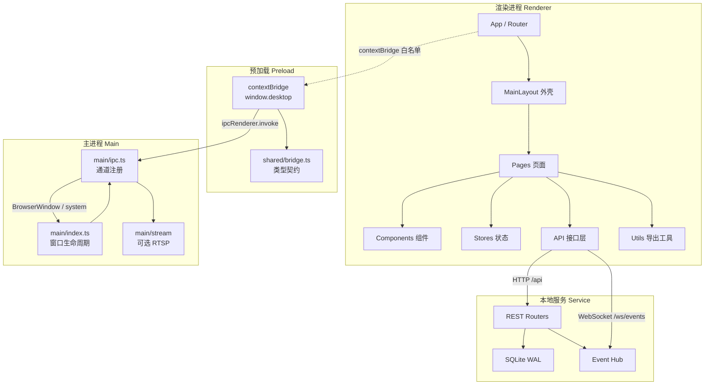

### 3.3 层间契约

- **渲染层 ↔ 主进程**：只通过 `window.desktop` 的四个命名空间（`win` / `service` / `report` / `stream`），
  通道名为 `domain:action`，参数与返回值为可结构化克隆的数据。
- **渲染层 ↔ 本地服务**：REST 走 `/api`，实时事件走 `/ws/events`，事件结构固定为 `AppEvent`。
- **类型来源**：跨进程契约集中在 `src/shared/bridge.ts`；HTTP 契约在前端 `types/index.ts` 与后端 `schemas.py` 中一一对应。

### 3.4 启动与首屏时序

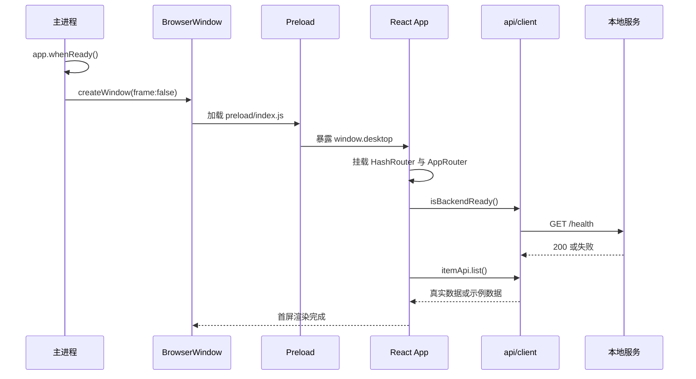

### 3.5 窗口控制调用链

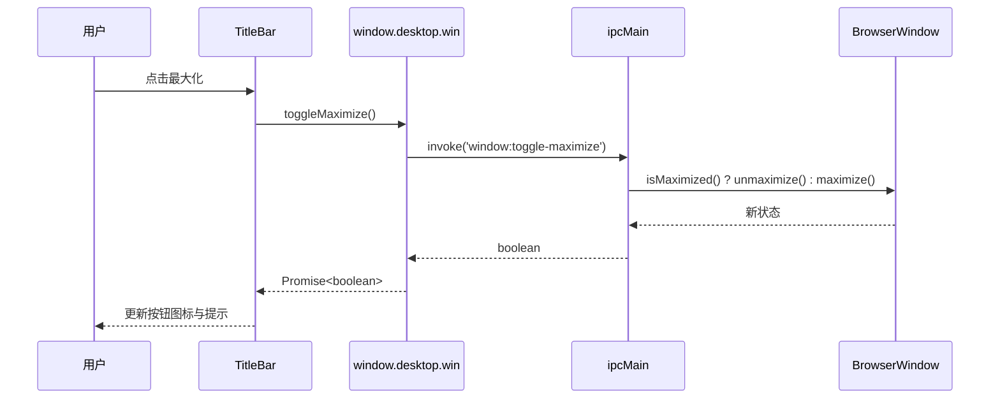

## 4. 关键设计决策

| 决策 | 备选方案 | 选择依据 | 影响 |
| --- | --- | --- | --- |
| 无边框 + 自绘标题栏 | 原生标题栏 | 原生标题栏无法承载品牌、页面上下文与状态信息 | 需自行实现窗口控制与拖拽区，已封装在 `ipc.ts` / `TitleBar.tsx` |
| HashRouter | BrowserRouter | 生产环境以 `file://` 加载，无服务端承载路由 | URL 含 `#`，对桌面端无影响 |
| axios + `withBackend` | React Query / SWR | 保持缓存策略中立，降级语义集中在一处 | 无自动缓存与请求去重，需要时在 `api` 层扩展 |
| Zustand | Redux / Context | 无 Provider 嵌套，订阅粒度细，适合事件流 | 时间旅行调试需额外中间件 |
| 令牌双源维护 | CSS-in-JS 单一源 | 保留原生 CSS 性能，同时让 AntD 复用同一组值 | 新增令牌需同步两处，已写入贡献规范 |
| FastAPI + SQLite | Node 侧后端 | 便于后续接入算法与数据处理；单文件便于分发 | 多实例并发写需替换数据库 |
| 内置示例域 | 空白模板 | 提供可运行的端到端参考，降低接入成本 | 正式使用前需按清单移除示例 |

### 4.1 标题栏拆分为三部分

- **拖拽区**：`-webkit-app-region: drag`，双击最大化；
- **交互区**：所有控件声明 `no-drag`，避免拖拽区吞掉点击事件；
- **能力桥**：`window.desktop.win` 提供四个方法；浏览器环境无该对象时整体隐藏控件。

该拆分保证同一份 UI 在 Electron 与浏览器联调下行为一致。

### 4.2 降级策略按状态码区分

```ts
// api/client.ts（节选）
if (axios.isAxiosError(e) && (!e.response || e.response.status >= 500)) {
  backendReady = false   // 服务不可用，降级为示例数据
  return mock()
}
throw e                  // 4xx 属于请求错误，交由调用方处理
```

降级只覆盖「服务未启动或不可用」，不掩盖参数与权限类错误；`backendReady` 缓存探测结果，避免重复健康检查。

### 4.3 设计令牌双源同步

AntD 组件读取 `ThemeConfig`，自建组件读取 CSS 变量。框架维持两处同值：

- `styles.css :root` 定义 `--ink`、`--line`、`--r-lg` 等变量；
- `theme.ts tokens` 以驼峰命名映射同值，并通过 `appTheme` 下发到组件级 token；
- ECharts 通过 `chart` 对象复用同一组颜色。

修改品牌色时，表格、按钮、图表与自建卡片同步更新。

### 4.4 打包体积控制

`electron-builder` 会将 `dependencies` 复制进 `app.asar`。渲染层依赖（react / antd / echarts 等）已由 Vite 打包进
`out/renderer`，因此放入 `devDependencies`；`dependencies` 仅保留主进程实际 `require` 的 `ws` 与 `ffmpeg-static`。
配合 `files: [out/**, package.json]`，安装包只包含运行时必需文件。

## 5. 数据流与调用链

### 5.1 列表查询

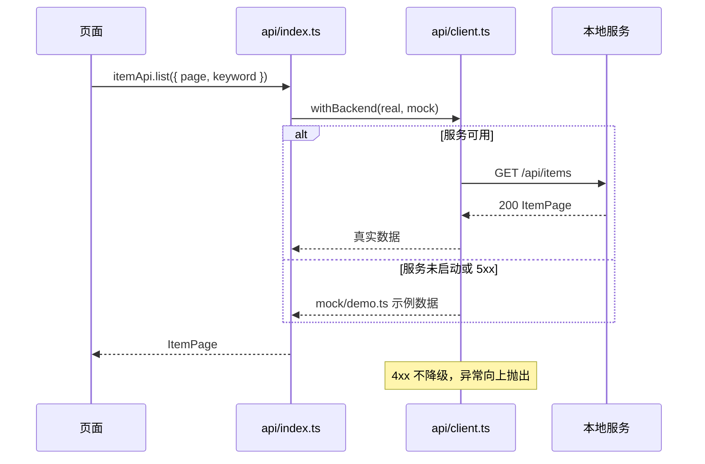

### 5.2 实时事件

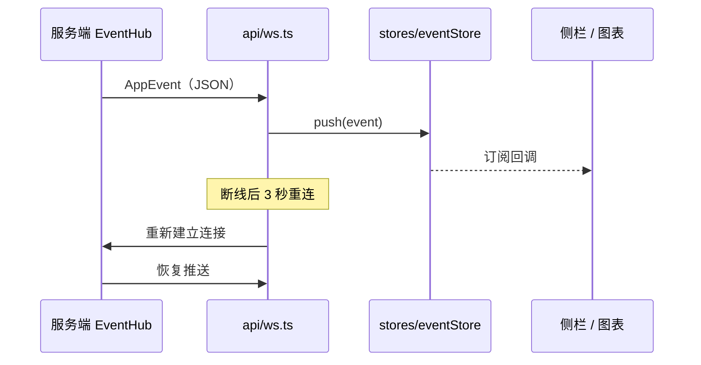

### 5.3 PDF 导出

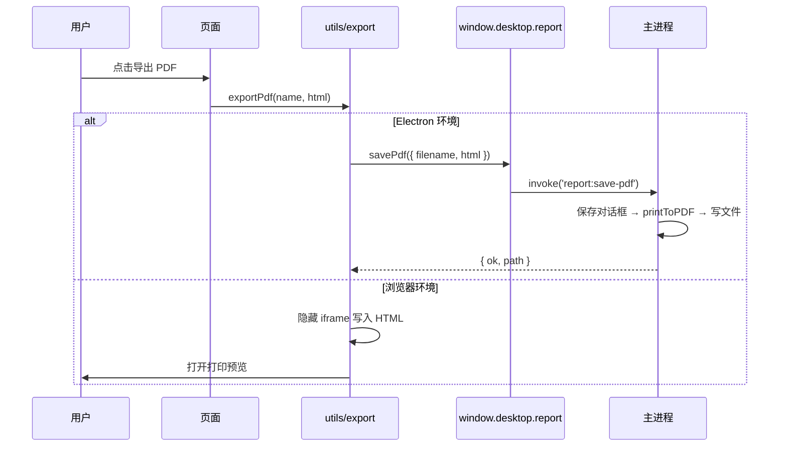

## 6. 模块划分与依赖规则

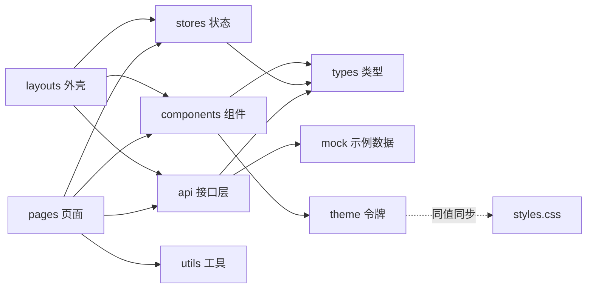

依赖方向为单向：

1. `pages` 可以依赖 `components` / `api` / `stores` / `utils`；
2. `components` 只依赖 `types` 与 `theme`，不发起网络请求；
3. 页面不直接使用 `axios`，统一通过 `api` 层，保证降级与鉴权扩展点集中。

## 7. 可裁剪设计

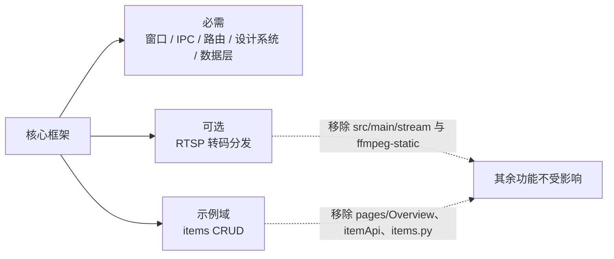

## 8. 技术选型

| 技术 | 选型依据 |
| --- | --- |
| Electron 31 | 桌面能力完整（窗口 / 打印 / 托盘 / 协议），主进程可安全承载 Node |
| React 18 + TypeScript | 组件化与类型推导成熟，接口字段错误在编译期暴露 |
| electron-vite（Vite 5） | 主进程 / preload / 渲染层统一配置，产物按 `out/` 分层 |
| Ant Design 5 | 企业级组件完备，ThemeConfig 可与自建令牌对齐 |
| ECharts 5 | 图表类型覆盖广，主题复用同一组颜色 |
| Zustand | 轻量、无 Provider，适合事件流与跨页状态 |
| FastAPI + Pydantic | 契约即代码并生成 OpenAPI，与前端 TS 类型一一对应 |
| SQLite（WAL） | 单文件、零部署、并发读友好，适合桌面单机 |

## 9. 目录结构

```
.
├── electron.vite.config.ts      # 主进程 / preload / 渲染层构建（含 dev 代理）
├── vite.web.config.ts           # 纯浏览器联调（仅 renderer）
├── electron-builder.yml         # Windows 打包（nsis + portable）
├── build/icon.ico               # 应用图标
├── docs/
│   ├── API.md                   # IPC / HTTP / WS / 前端模块契约
│   ├── ARCHITECTURE.md          # 分层、依赖约束、安全基线
│   └── images/                  # README 截图与标识
├── src/
│   ├── main/                    # 主进程
│   │   ├── index.ts             # 窗口创建、生命周期、流服务
│   │   ├── ipc.ts               # window / service / report / stream 通道
│   │   └── stream/              # 可选：RTSP → MPEG1-TS
│   ├── preload/                 # contextBridge 实现与全局类型
│   ├── shared/                  # 跨进程类型契约（无 electron 依赖）
│   └── renderer/src/
│       ├── router/              # 路由表
│       ├── layouts/             # 标题栏 + 侧栏 + 主区 + 概况栏
│       ├── components/          # TitleBar / UI 原子 / Tag / RoiCanvas
│       ├── pages/               # Overview / Components / Settings
│       ├── api/                 # client / ws / 接口集合
│       ├── stores/              # Zustand
│       ├── mock/                # 示例数据
│       ├── types/               # 公共类型
│       ├── utils/               # CSV / PDF 导出
│       ├── theme.ts             # 主题与令牌
│       └── styles.css           # 设计系统
└── ai-service/                  # FastAPI + SQLite 示例服务
    ├── run.py
    ├── configs/settings.yaml
    └── app/                     # main / config / db / schemas / api / ws
```

## 10. 界面预览

截图为实际运行界面（1440×900，示例数据）。

### 10.1 总览页

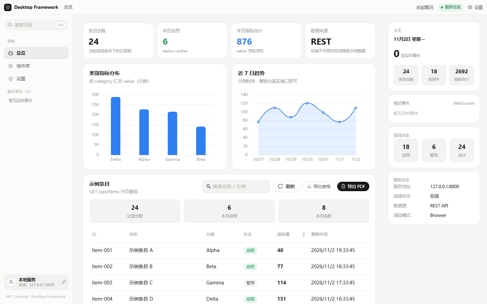

### 10.2 组件库

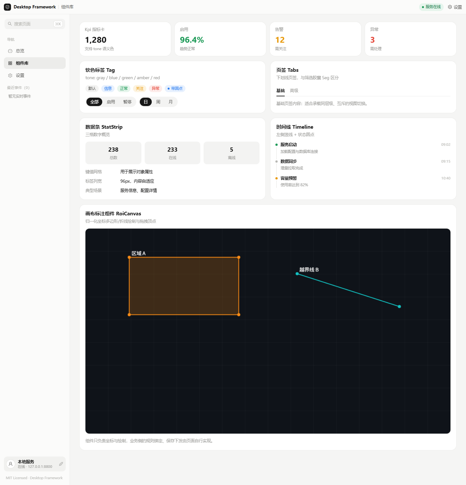

### 10.3 设置页

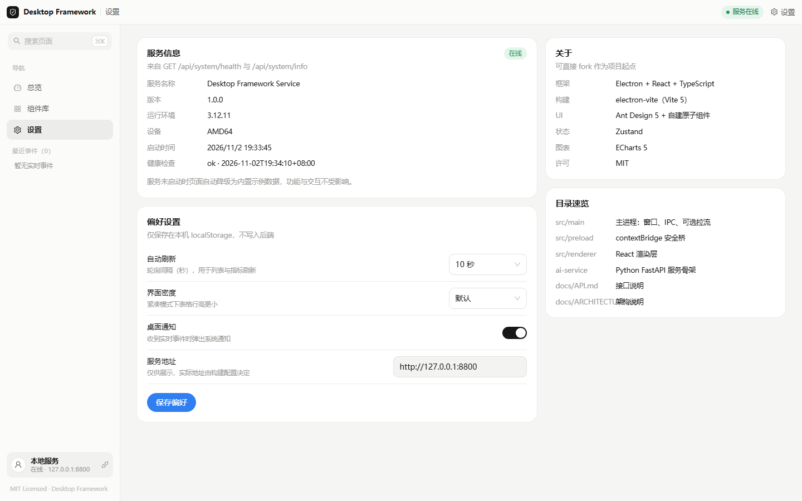

### 10.4 交互状态

| 关键词筛选 | 概况栏收起 |
| --- | --- |
| 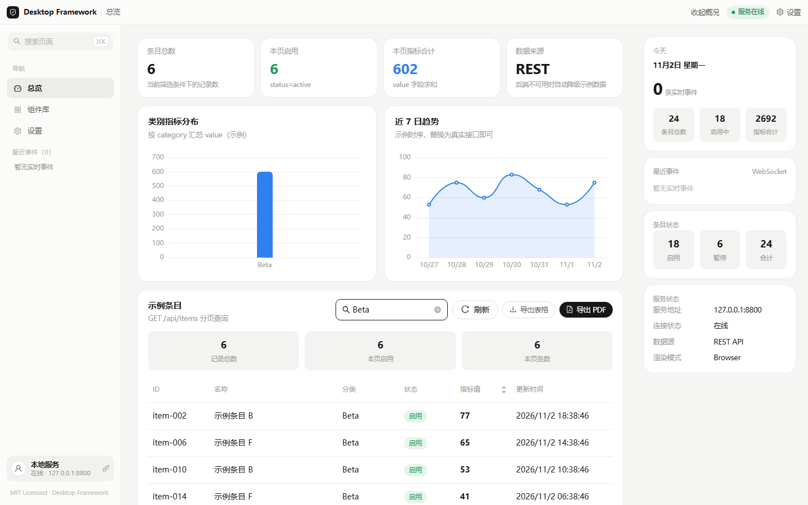 | 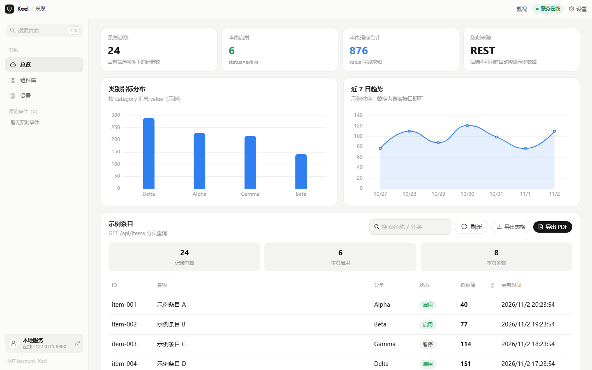 |
| **分页浏览** | **组件库交互** |
| 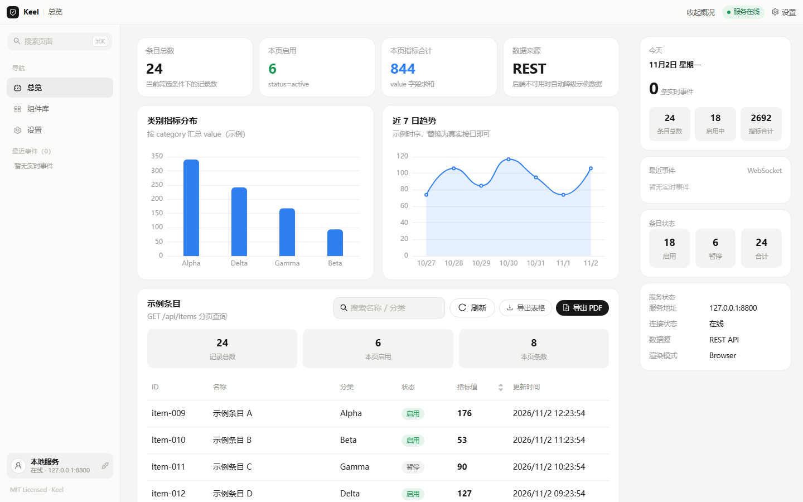 | 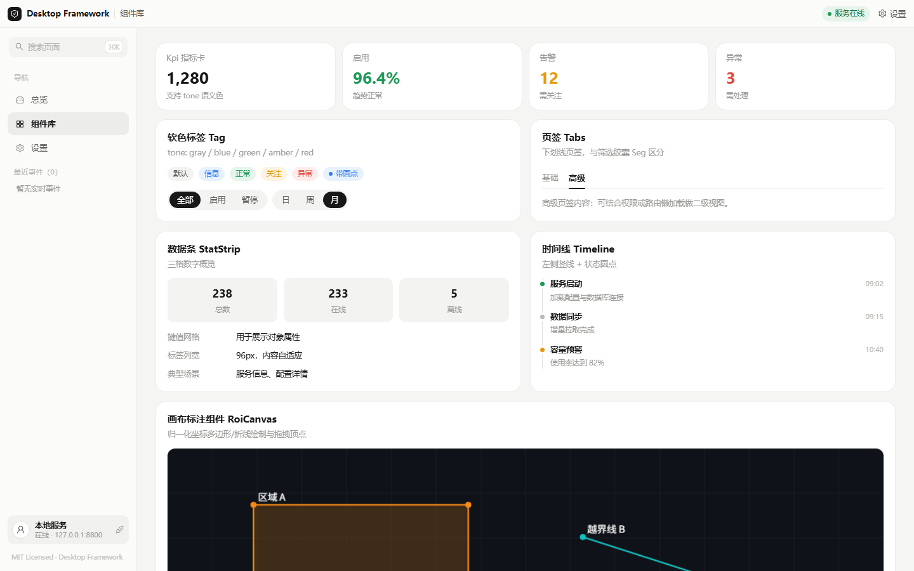 |
| **全局搜索（⌘K）** | **偏好设置** |
| 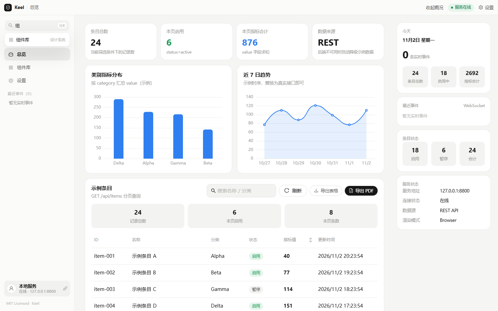 | 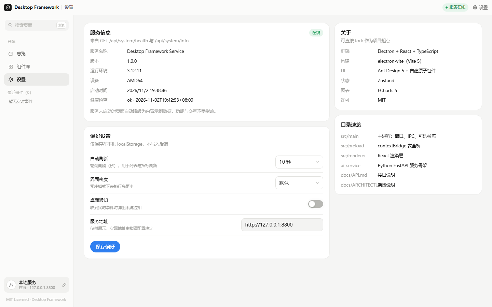 |

## 11. 快速开始

### 11.1 环境要求

- Node.js ≥ 18（建议 20 LTS）
- npm ≥ 9（或 pnpm / yarn）
- Python ≥ 3.10（仅本地服务需要）

### 11.2 安装与启动

```bash
# 克隆仓库
git clone git@github.com:gqallen931/electron-react-desktop-framework.git
cd electron-react-desktop-framework

# 安装前端依赖
npm install

# 安装并启动本地服务（可选；未启动时前端使用示例数据）
cd ai-service
pip install -r requirements.txt
python run.py            # http://127.0.0.1:8800

# 启动桌面端（开发模式）
cd ..
npm run dev
```

### 11.3 可用命令

| 命令 | 作用 |
| --- | --- |
| `npm run dev` | Electron 开发模式（主进程 + 渲染层热更新） |
| `npm run dev:web` | 纯浏览器联调（http://localhost:5180） |
| `npm run build` | 构建到 `out/` |
| `npm start` | 预览构建产物 |
| `npm run typecheck` | 渲染层与主进程类型检查 |
| `npm run dist:win` | 打包 Windows 安装包与免安装版到 `release/` |

## 12. 质量与验证

| 项 | 规则 |
| --- | --- |
| 类型检查 | 双项目配置（web / node），`strict`、`isolatedModules`、`useDefineForClassFields`、`noFallthroughCasesInSwitch` 开启 |
| 跨进程类型 | 契约集中在 `src/shared/bridge.ts`，渲染层不引入 Electron 实现 |
| 增量缓存 | `tsBuildInfoFile` 指向 `node_modules/.cache`，不污染仓库 |
| 构建 | `electron-vite build` 产出 `out/main`、`out/preload`、`out/renderer` |
| 打包 | `electron-builder` 产出 NSIS 安装包与 portable 版本 |

```bash
npm run typecheck   # tsc --noEmit -p tsconfig.web.json && tsc --noEmit -p tsconfig.node.json
npm run build
```

## 13. API 使用

完整契约见 [docs/API.md](docs/API.md)。摘要：

```ts
import { itemApi, systemApi } from '@/api'

const page = await itemApi.list({ page: 1, page_size: 10, keyword: '示例' })
const created = await itemApi.create({ name: '新条目', category: 'Alpha', status: 'active', value: 10 })
await itemApi.update(created.id, { value: 20 })
await itemApi.remove(created.id)
const health = await systemApi.health()
```

实时事件与主进程能力：

```ts
import { eventStream } from '@/api/ws'
import { useEventStore } from '@/stores/eventStore'

eventStream.connect()
const off = eventStream.subscribe((event) => useEventStore.getState().push(event))

await window.desktop.win.toggleMaximize()
await window.desktop.report.savePdf({ filename: 'report', html })
```

## 14. 二次开发

### 14.1 新增页面

1. 在 `src/renderer/src/pages/YourPage/index.tsx` 创建页面；
2. 在 `router/index.tsx` 注册路由；
3. 在 `layouts/MainLayout.tsx` 的 `NAV_ITEMS` 增加导航项，并补充 `ROUTE_META`。

### 14.2 接入业务接口

1. `types/index.ts` 定义实体与分页类型；
2. `api/index.ts` 增加 `xxxApi`（复用 `withBackend` 保留降级能力）；
3. `ai-service/app/schemas.py` 定义 Pydantic 模型，`api/` 下新增路由；
4. 实时推送调用 `app/ws/events.py` 的 `hub.broadcast_threadsafe(...)`。

### 14.3 移除示例

- 删除 `mock/demo.ts`；
- 移除 `api/index.ts` 中 `withBackend` 的 mock 分支；
- 删除 `pages/Overview`、`ai-service/app/api/items.py` 与对应路由。

### 14.4 设计令牌

同时修改 `src/renderer/src/styles.css` 的 `:root` 与 `src/renderer/src/theme.ts` 的 `tokens` / `appTheme`。

### 14.5 新增 IPC

`src/main/ipc.ts` 注册 → `src/shared/bridge.ts` 定义契约 → `src/preload/index.ts` 实现 → 渲染层直接使用。

## 15. 贡献

见 [CONTRIBUTING.md](CONTRIBUTING.md)。提交前需通过 `npm run typecheck`；提交信息遵循 Conventional Commits；
不提交 `node_modules`、`out`、`release`、`runtime` 等生成物。

## 16. 许可证

[MIT License](LICENSE)。

## 17. FAQ

| 问题 | 处理 |
| --- | --- |
| 页面显示「服务离线」 | 本地服务未启动；运行 `ai-service/run.py` 或继续使用示例数据 |
| 端口冲突 | 修改 `ai-service/configs/settings.yaml` 的 `port`，并同步两处 vite 代理 |
| 打包下载失败 | 配置 `ELECTRON_MIRROR` 与 `ELECTRON_BUILDER_BINARIES_MIRROR` 镜像 |
| 不需要 RTSP | 删除 `src/main/stream/`、stream 通道、preload 的 `stream` 暴露与 `ffmpeg-static` |
| 需要应用内多语言 | 引入 i18n 库，文案集中在 `locales/`，标题栏与导航同步读取 |
