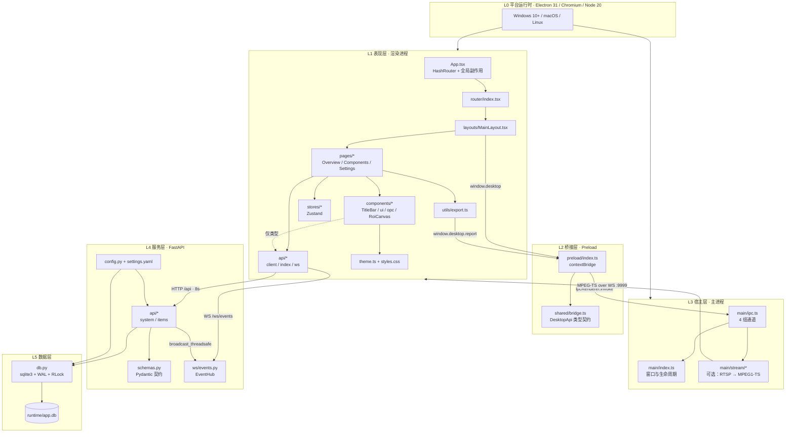
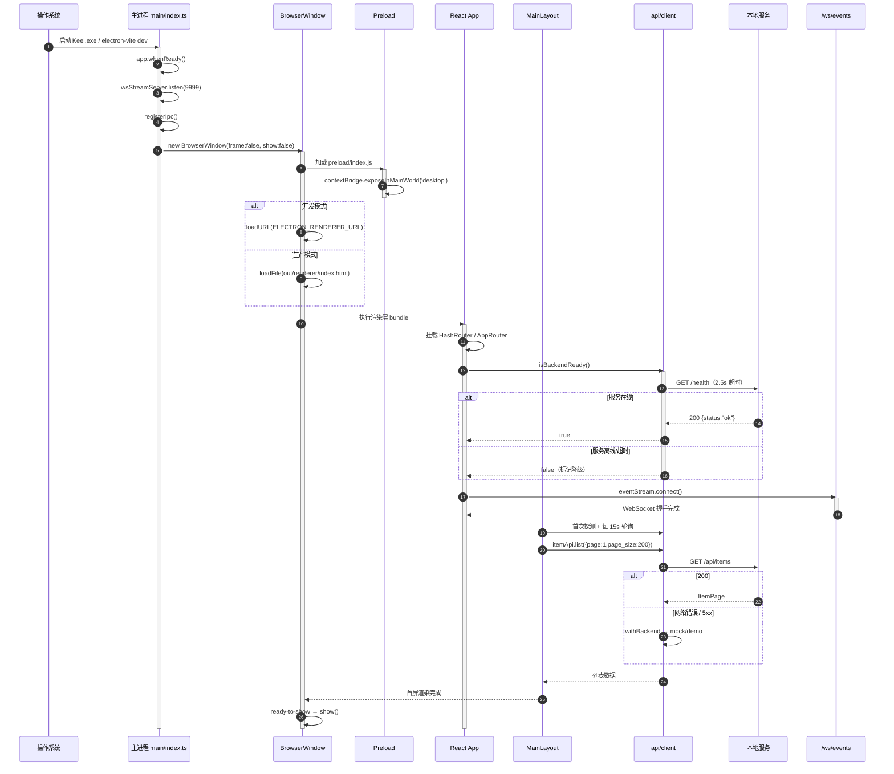
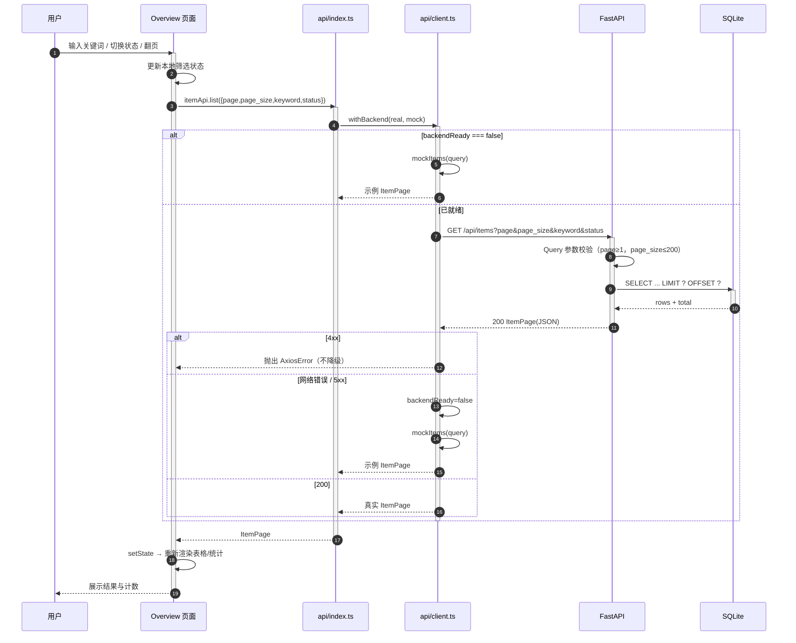
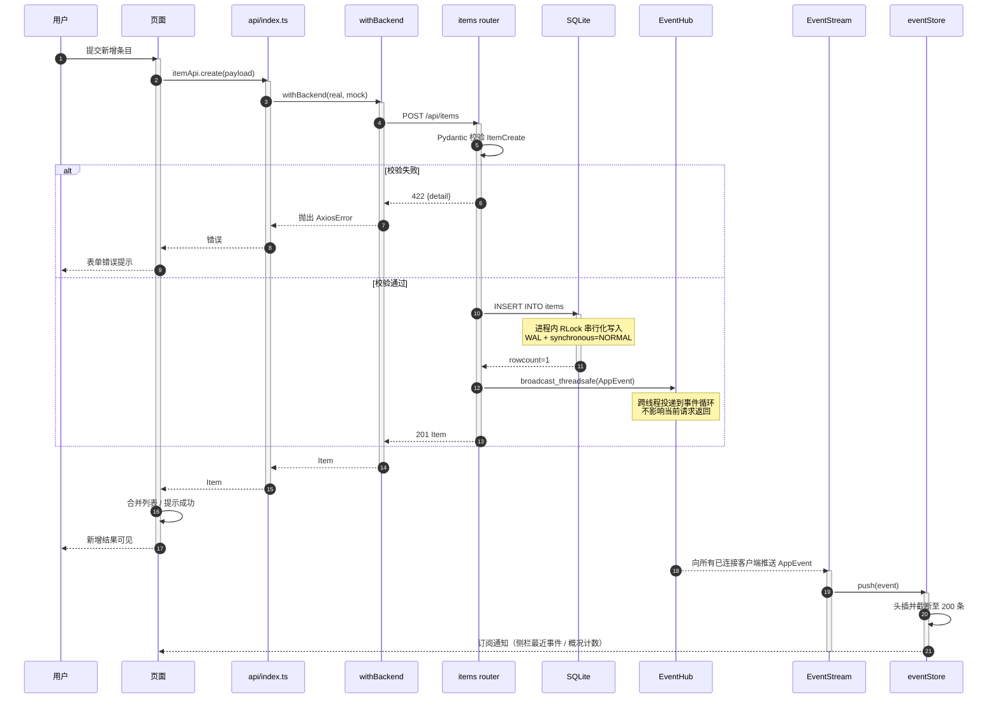
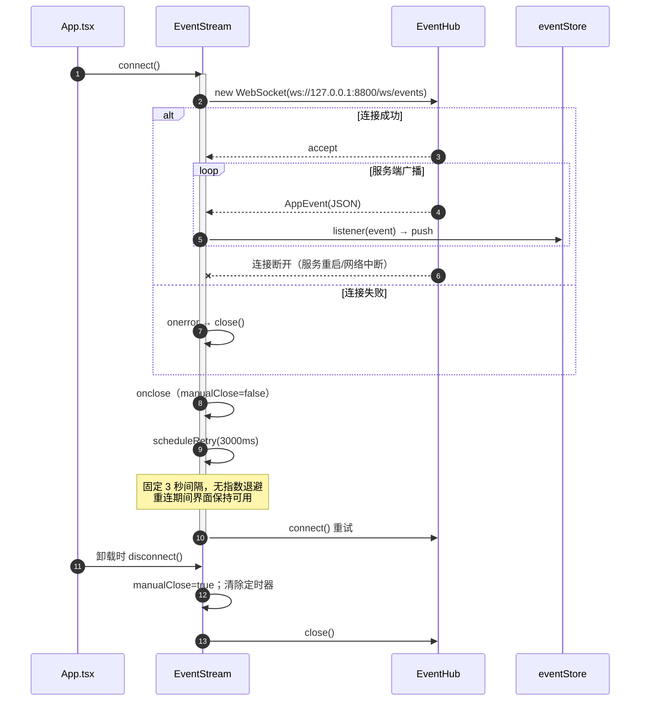
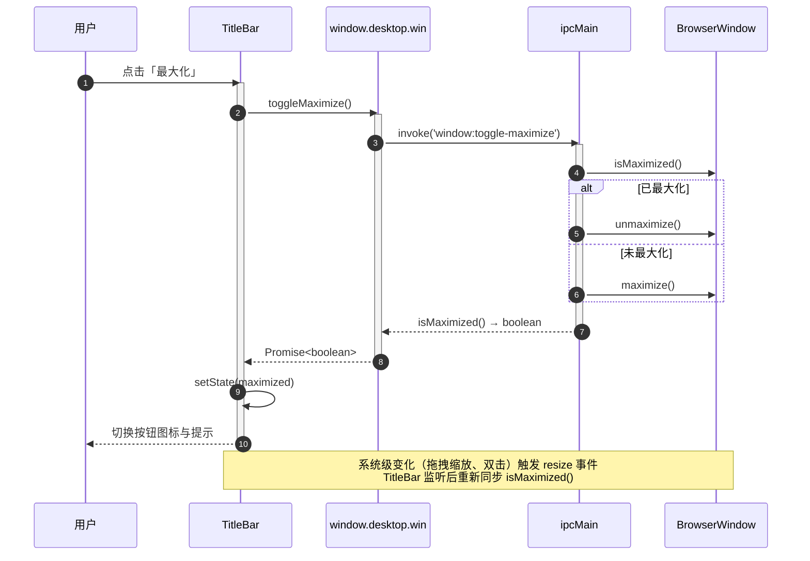
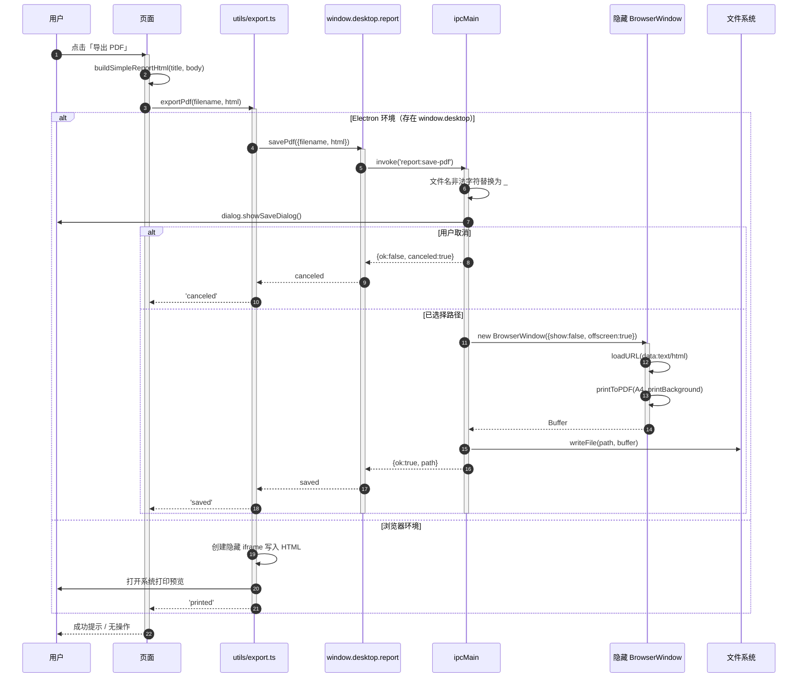
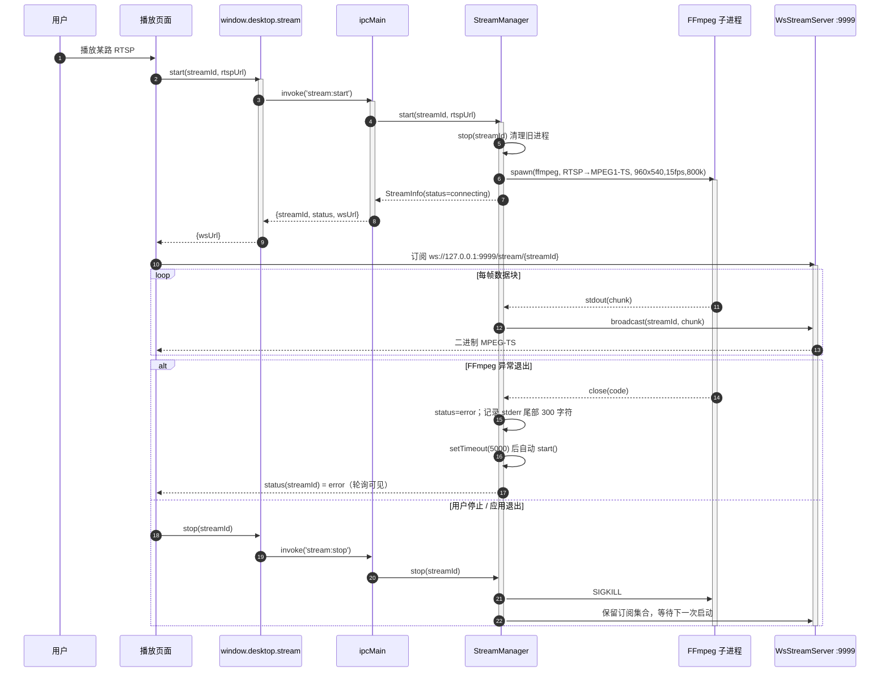
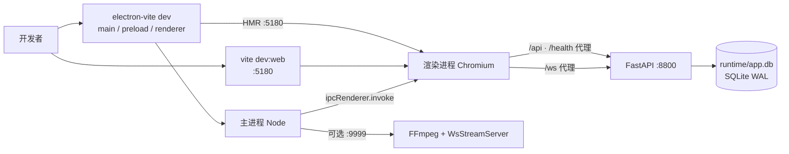
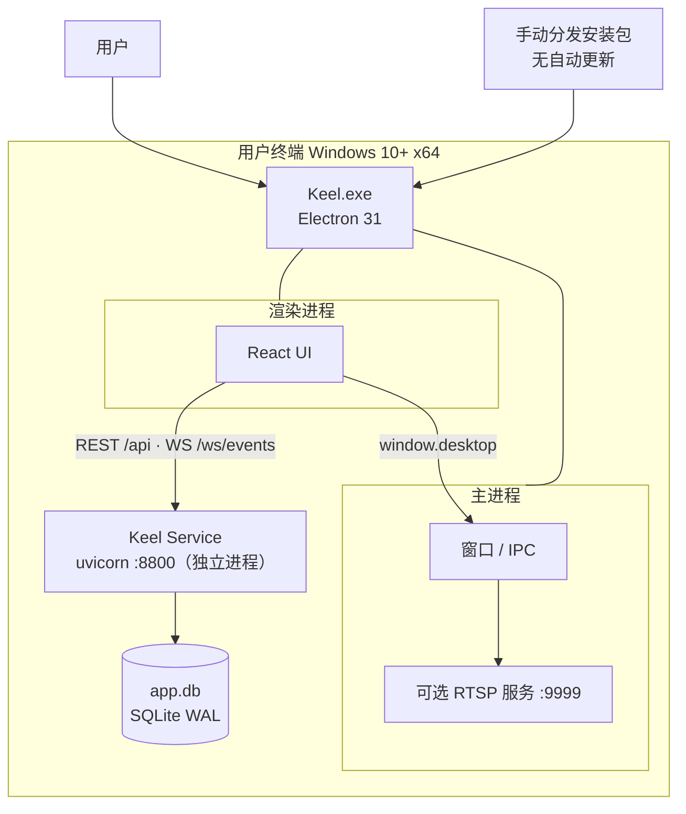

# Keel 架构设计文档

| 项目 | 内容 |
| --- | --- |
| 文档版本 | v1.0.0 |
| 文档状态 | 已生效（Architecture Baseline） |
| 适用版本 | Keel 1.0.x |
| 适用读者 | 前端 / 桌面端 / 服务端开发、测试、架构评审人 |
| 维护责任 | Keel Maintainers，随架构变更同步更新 |
| 更新日期 | 2026-11-02 |
| 关联文档 | [README](../README.md) · [API 契约](API.md) · [贡献指南](../CONTRIBUTING.md) |

> 本文描述的是**当前代码的真实结构**，不是规划稿。凡标注「已知取舍 / 演进项」的内容，表示当前版本尚未实现，
> 评审时不应假设其存在。

---

## 目录

1. [项目整体架构概述](#1-项目整体架构概述)
2. [系统分层结构](#2-系统分层结构)
3. [核心模块交互时序](#3-核心模块交互时序)
4. [核心模块详细说明](#4-核心模块详细说明)
5. [质量属性设计](#5-质量属性设计)
6. [部署架构](#6-部署架构)
7. [架构约束与评审清单](#7-架构约束与评审清单)
8. [已知取舍与演进方向](#8-已知取舍与演进方向)
9. [附录](#9-附录)

---

## 1. 项目整体架构概述

### 1.1 项目定位

Keel 是一个**可裁剪的桌面应用工程骨架**，用于在 Electron + React 技术栈上快速搭建具备企业级观感与工程约束的
桌面客户端。它不提供具体业务，而是提供四类可复用的基础能力：

1. **桌面宿主能力**：无边框窗口、自绘标题栏、系统级 IPC（窗口控制、打印、文件落盘）；
2. **设计与界面骨架**：设计令牌、主题、原子组件、页面外壳（标题栏 + 侧栏 + 主区 + 概况栏）；
3. **数据访问骨架**：REST 封装、健康探测、按错误语义降级、WebSocket 实时通道；
4. **本地服务样板**：FastAPI + Pydantic + SQLite，含分页 CRUD、事件广播与健康检查。

**非目标**：不绑定任何行业领域、不内置账号体系、不内置自动更新、不承诺多窗口与多实例能力。

### 1.2 设计目标

| 编号 | 目标 | 验收口径 | 实现方式 |
| --- | --- | --- | --- |
| G1 | 边界清晰 | 渲染层零 Node/Electron 直接依赖 | `contextIsolation: true` + preload 白名单 + tsconfig 工程隔离 |
| G2 | 开箱即用 | 克隆后仅安装依赖即可看到完整界面 | `mock/` 内置示例数据；服务缺失时自动降级 |
| G3 | 可裁剪 | 删除流媒体或示例域不影响其余功能 | 可选模块物理隔离（`main/stream`、`items`） |
| G4 | 类型安全 | 跨进程与 HTTP 契约在编译期可校验 | `shared/bridge.ts`、`types/index.ts`、`schemas.py` 三处对齐 |
| G5 | 观感一致 | Electron 与浏览器联调视觉一致 | 设计令牌双源同步 + CSS 变量 + AntD ThemeConfig |
| G6 | 发布可控 | 一条命令产出安装版与免安装版 | `electron-builder`（nsis + portable） |
| G7 | 低耦合 | 后端可整体替换而不改页面 | 页面只依赖 `api/index.ts` 的领域方法 |

### 1.3 核心设计原则

| 原则 | 含义 | 落地约束 |
| --- | --- | --- |
| P1 单向依赖 | 依赖方向永远由「表现」指向「基础」 | 见 [2.6 依赖规则](#26-依赖规则与跨层禁令) |
| P2 契约先行 | 跨边界的数据结构只有一处定义 | IPC → `shared/bridge.ts`；HTTP → `types` / `schemas` |
| P3 能力最小化 | 渲染层只能看到完成工作所需的 API | preload 仅暴露 4 个命名空间，不暴露 `ipcRenderer` |
| P4 失败可降级 | 服务不可用时界面仍可用 | `withBackend()` 统一降级策略 |
| P5 关注点分离 | 展示、编排、状态、传输、持久化各自独立 | `components` 不发请求；`pages` 不直接用 `axios` |
| P6 可裁剪 | 可选能力不侵入核心路径 | 流媒体、示例域可整块删除 |
| P7 显式优于隐式 | 关键行为写在代码与文档中，不靠约定俗成 | 通道命名 `domain:action`；降级按状态码显式区分 |

### 1.4 技术选型与依据

| 技术 | 在架构中的角色 | 选择依据 | 放弃的备选方案 |
| --- | --- | --- | --- |
| Electron 31 | 桌面运行时宿主 | 窗口、打印、文件、协议能力完整；主进程可承载 Node 能力；生态成熟 | Tauri（需额外引入 Rust 工具链，团队成本高）、NW.js（生态与维护活跃度较弱） |
| React 18 + TypeScript 5 | 渲染层框架与类型系统 | 组件化成熟、类型推导完善、人才供给充足 | Vue 3（同样可行，但团队既有资产以 React 为主） |
| electron-vite（Vite 5） | 三进程统一构建 | 主进程 / preload / 渲染层配置集中；HMR 快；产物结构清晰 | 手写 Webpack 多配置（维护成本高） |
| Ant Design 5 | 企业级组件与主题 | ThemeConfig 可与自建令牌同值映射；组件覆盖度高 | 纯自研（周期长）、MUI（视觉语言与目标风格差异大） |
| ECharts 5 | 图表与可视化 | 图表类型全、主题可复用同一组颜色 | Recharts（复杂图表能力有限） |
| Zustand 4 | 跨页状态 | 无 Provider 嵌套、订阅粒度细、体积小 | Redux Toolkit（样板代码多）、Context（频繁更新易引发大范围重渲染） |
| axios | HTTP 客户端 | 拦截器与错误分类能力完整，便于统一超时与降级 | fetch（需自行封装超时、错误分类） |
| FastAPI + Pydantic 2 | 本地服务与契约 | 类型即契约、自动生成 OpenAPI、Python 侧算法接入方便 | Node/Express（与前端同语言，但不利于后续接入数据处理生态） |
| SQLite（WAL） | 本地持久化 | 单文件、零部署、读并发友好 | LevelDB（查询能力弱）、嵌入式 PostgreSQL（部署重） |

---

## 2. 系统分层结构

### 2.1 逻辑分层

系统按运行时划分为 **5 个逻辑层**，另有 1 个贯穿构建期的工程层：

| 层 | 名称 | 运行时形态 | 核心制品 |
| --- | --- | --- | --- |
| L0 | 平台运行时 | Electron（Chromium + Node.js 20） | 无（由 Electron 提供） |
| L1 | 表现层（Renderer） | 渲染进程（Chromium） | `src/renderer/src/**` |
| L2 | 桥接层（Bridge） | Preload 上下文 | `src/preload/**`、`src/shared/bridge.ts` |
| L3 | 宿主层（Host） | 主进程（Node） | `src/main/**` |
| L4 | 服务层（Service） | 独立 Python 进程（uvicorn） | `ai-service/app/**` |
| L5 | 数据层（Storage） | 进程内嵌 SQLite 文件 | `ai-service/runtime/app.db` |
| E | 工程层（Engineering） | 构建机 | `electron.vite.config.ts`、`electron-builder.yml`、`tsconfig*.json` |

### 2.2 分层视图

### 2.3 各层职责边界

| 层 | 核心职责 | 核心能力 | 明确不承担 |
| --- | --- | --- | --- |
| L1 表现层 | 视图渲染、交互编排、状态管理、接口调用 | 路由、页面外壳、原子组件、设计令牌、数据获取与降级、导出 | 直接访问 Node/文件系统；直接创建窗口；直接读写数据库 |
| L2 桥接层 | 把主进程能力以最小白名单暴露给渲染层 | 4 组命名空间（`win`/`service`/`report`/`stream`）；跨进程类型契约 | 业务逻辑；数据转换；状态管理 |
| L3 宿主层 | 管理窗口与应用生命周期，提供系统级能力 | 窗口创建与生命周期、IPC 注册、健康探测代理、PDF 打印、可选流媒体 | 业务规则、页面状态、数据持久化 |
| L4 服务层 | 提供 HTTP/WS 契约与业务校验 | 路由、Pydantic 校验、错误语义、事件广播、配置加载 | 界面渲染；桌面窗口控制 |
| L5 数据层 | 持久化与查询 | 建表、分页查询、CRUD、WAL、写串行化 | 业务编排；跨进程通信 |

### 2.4 模块划分规范

| 目录 | 聚合粒度 | 命名规范 | 划分规则 |
| --- | --- | --- | --- |
| `pages/<Domain>/` | 一个路由页面 | 目录与组件同用 PascalCase | 只做「取数 + 组合 + 交互编排」，不沉淀通用逻辑 |
| `components/` | 可复用 UI 单元 | 文件 PascalCase，导出组件同名 | 纯展示 + 回调；不引入 `api`、不读全局 store |
| `layouts/` | 页面外壳 | PascalCase | 承载导航、标题栏、概况栏等跨页结构 |
| `api/` | 一个后端资源一个对象 | 文件 camelCase，对象 `<resource>Api` | 仅做 URL/参数/返回值映射与降级，不含业务判断 |
| `stores/` | 一个领域状态一个 store | `use<Domain>Store` | 仅状态与同步动作，不发请求 |
| `utils/` | 无状态工具 | 动词开头 camelCase | 纯函数优先；副作用仅限浏览器下载/打印 |
| `shared/` | 跨进程契约 | camelCase | **禁止**引入 `electron` / `node` 模块 |
| `main/` | 宿主能力 | 文件 camelCase | 按能力拆分（window / ipc / stream），不承载业务 |
| `ai-service/app/api/` | 一个资源一个 router | snake_case | 路由层只做参数校验与编排，SQL 收敛到 `db.py` |

### 2.5 层间通信契约

| 调用方 → 被调方 | 传输方式 | 契约定义位置 | 超时 / 重试 | 错误语义 |
| --- | --- | --- | --- | --- |
| 渲染层 → 桥接层 | `window.desktop.<ns>.<method>()` | `src/shared/bridge.ts` 的 `DesktopApi` | 无超时（IPC 本地调用） | 返回 `{ ok, error? }` 或抛出 |
| 桥接层 → 宿主层 | `ipcRenderer.invoke('domain:action', ...)` | 通道名 + 参数签名（`ipc.ts` 与 `preload/index.ts` 成对维护） | 无重试 | `ipcMain.handle` 返回值/异常 |
| 渲染层 → 服务层（REST） | HTTP JSON，`/api/**` | 前端 `types/index.ts` ↔ 后端 `schemas.py` | axios 8s；不自动重试 | 4xx 向上抛出，5xx/网络错误触发降级 |
| 渲染层 → 服务层（事件） | WebSocket `/ws/events` | `AppEvent` | 断线 3s 固定重连 | 非 JSON 帧忽略 |
| 宿主层 → 服务层（健康探测） | `net.fetch GET /health` | 无结构体，仅 `ok/status` | 由调用方决定 | 异常转 `{ ok: false, error }` |
| 宿主层 → 渲染层（流媒体） | WebSocket 二进制帧 `/stream/<id>` | MPEG1-TS 码流（JSMpeg 可解码） | 播放端自行重连 | 非 `/stream/` 路径直接关闭 |

**契约演进规则**：

1. **只增不改**：新增字段必须可选并有默认值；删除/重命名字段视为破坏性变更，需要同步三处（类型、模型、文档）。
2. **IPC 成对修改**：新增通道必须同时改 `ipc.ts`、`preload/index.ts`、`shared/bridge.ts`，三者缺一视为未完成。
3. **HTTP 命名**：请求/响应体使用 `camelCase`；查询参数与分页字段沿用 `snake_case`（`page_size`）。
4. **时间格式**：统一 ISO 8601 本地时区字符串，精确到秒。
5. **错误结构**：HTTP 错误体固定为 `{ "detail": "..." }`，由 FastAPI `HTTPException` 产生。

### 2.6 依赖规则与跨层禁令

以下规则为**架构级约束**，评审时按编号引用。

| 编号 | 规则 | 类型 | 当前保障手段 |
| --- | --- | --- | --- |
| R1 | `renderer` 不得 `import` `electron`、`node:*`、`src/main/**` | 禁止 | `tsconfig.web.json` 仅含 `vite/client` 类型；代码评审 |
| R2 | `main` 不得 `import` `src/renderer/**` | 禁止 | 构建入口隔离；代码评审 |
| R3 | `preload` 不得 `import` `src/renderer/**` 或业务代码 | 禁止 | 代码评审 |
| R4 | `shared/**` 不得依赖 `electron`、`node`、浏览器 API，只能是纯类型/常量 | 禁止 | 其被 web 与 node 两套 tsconfig 同时包含，天然限制 |
| R5 | `components/**` 不得 `import` `api/**`、`stores/**`、`pages/**` | 禁止 | 代码评审 |
| R6 | `pages/**` 不得直接 `import` `axios`，必须经 `api/**` | 禁止 | 代码评审 |
| R7 | `stores/**` 不得 `import` `api/**`，保持状态层无 I/O | 禁止 | 代码评审 |
| R8 | 渲染层不得绕过 `window.desktop` 调用 `ipcRenderer` | 禁止 | preload 不暴露 `ipcRenderer`；`contextIsolation: true` |
| R9 | `ai-service` 不得依赖桌面端代码；桌面端不得直连 SQLite 文件 | 禁止 | 进程与目录隔离 |
| R10 | 页面/组件不得直接拼接后端 URL，统一走 `api/index.ts` | 禁止 | 代码评审 |

**依赖矩阵**（行 → 列表示「行可以依赖列」）：

|  | pages | layouts | components | api | stores | utils | types | theme | shared | main |
| --- | --- | --- | --- | --- | --- | --- | --- | --- | --- | --- |
| pages | — | ✗ | ✓ | ✓ | ✓ | ✓ | ✓ | ✓ | ✗ | ✗ |
| layouts | ✗ | — | ✓ | ✓ | ✓ | ✓ | ✓ | ✓ | ✗ | ✗ |
| components | ✗ | ✗ | ✓ | ✗ | ✗ | ✓ | ✓ | ✓ | ✗ | ✗ |
| api | ✗ | ✗ | ✗ | ✓ | ✗ | ✗ | ✓ | ✗ | ✗ | ✗ |
| stores | ✗ | ✗ | ✗ | ✗ | ✓ | ✗ | ✓ | ✗ | ✗ | ✗ |
| utils | ✗ | ✗ | ✗ | ✗ | ✗ | ✓ | ✓ | ✗ | ✗ | ✗ |
| preload | ✗ | ✗ | ✗ | ✗ | ✗ | ✗ | ✗ | ✗ | ✓ | ✗ |
| main | ✗ | ✗ | ✗ | ✗ | ✗ | ✗ | ✗ | ✗ | ✓ | ✓ |

> `api/**` 允许依赖 `mock/**`，`mock` 属于示例数据资产，不向其他层开放。

### 2.7 模块与源码映射

| 模块 | 关键文件 |
| --- | --- |
| 应用装配 | `src/renderer/src/App.tsx`、`main.tsx` |
| 路由 | `router/index.tsx` |
| 页面外壳 | `layouts/MainLayout.tsx` |
| 标题栏 | `components/TitleBar.tsx` |
| 原子组件 | `components/ui.tsx`、`components/opc.tsx`、`components/RoiCanvas.tsx` |
| 数据访问 | `api/client.ts`、`api/index.ts`、`api/ws.ts` |
| 状态 | `stores/eventStore.ts` |
| 导出 | `utils/export.ts` |
| 设计系统 | `theme.ts`、`styles.css` |
| 窗口与生命周期 | `src/main/index.ts` |
| IPC | `src/main/ipc.ts` |
| 流媒体（可选） | `src/main/stream/StreamManager.ts`、`WsStreamServer.ts` |
| 桥接 | `src/preload/index.ts`、`src/shared/bridge.ts` |
| 服务入口 | `ai-service/app/main.py`、`ai-service/run.py` |
| 服务路由 | `ai-service/app/api/system.py`、`api/items.py` |
| 服务契约 | `ai-service/app/schemas.py` |
| 持久化 | `ai-service/app/db.py` |
| 事件中心 | `ai-service/app/ws/events.py` |
| 配置 | `ai-service/app/config.py`、`configs/settings.yaml` |

---

## 3. 核心模块交互时序

> 以下时序图采用 UML 标准语义：实线箭头为同步调用，虚线箭头为返回/异步推送，
> `alt/else/end` 表示分支，`loop` 表示重复，`Note` 为约束说明。

### 3.1 冷启动与首屏加载

**前置条件**：应用未运行；本地服务可选（未启动时走降级）。

**后置条件**：主窗口可见；标题栏显示服务状态；侧栏与概况栏完成首次数据填充。

**异常分支**：

- 渲染进程加载失败：`ready-to-show` 不触发，窗口保持隐藏（当前无显式错误页，属演进项）；
- 本地服务未启动：健康探测为 `false`，页面使用 `mock/demo.ts` 数据，写入操作返回合成对象且**不持久化**。

### 3.2 分页查询与降级

**关键约束**：

1. 降级只发生在「无响应」或「5xx」，4xx 视为请求本身错误并向上抛出；
2. 降级状态被缓存（`backendReady = false`），后续请求直接走 mock，直到下一次健康探测成功；
3. 健康探测每 15 秒执行一次，探测成功会恢复 `backendReady = true`。

### 3.3 写操作与实时事件广播

**注意**：当前版本没有「事件去重」与「写入即刷新」的强一致保证。页面列表通过自身请求结果更新，
WebSocket 事件用于侧栏与概况展示；若需要列表实时一致，应在页面订阅 store 并按事件增量更新（演进项）。

### 3.4 WebSocket 断线重连

### 3.5 窗口控制（自绘标题栏）

**约束**：拖拽区使用 `-webkit-app-region: drag`，所有可交互元素必须声明 `no-drag`；
浏览器环境不存在 `window.desktop`，窗口控制按钮整体不渲染。

### 3.6 PDF 导出（双路径）

### 3.7 可选：RTSP 流启动与异常自愈

> 该链路为**可选能力**。删除 `src/main/stream/`、`stream:*` 三组 IPC、preload 的 `stream` 段与
> `ffmpeg-static` 依赖后，其余功能不受影响。

---

## 4. 核心模块详细说明

### 4.1 窗口与生命周期模块

| 项 | 内容 |
| --- | --- |
| 定义 | `src/main/index.ts`，负责应用启动、窗口创建、退出清理 |
| 功能 | 无边框窗口创建；开发/生产加载策略；外链交给系统浏览器；退出时停止所有流并关闭 WS 服务 |
| 核心接口 | `createWindow(): BrowserWindow`；监听 `app.whenReady`、`activate`、`window-all-closed`、`before-quit` |
| 依赖 | `electron`、`main/ipc`、`main/stream/*` |
| 非功能 | 窗口默认 1440×900，最小 1080×720；背景色 `#f5f5f4` 避免白屏闪烁；`show:false` + `ready-to-show` 控制首帧 |

关键配置：

| 配置 | 值 | 理由 |
| --- | --- | --- |
| `frame` | `false` | 使用自绘标题栏承载品牌与页面信息 |
| `title` | `Keel` | 任务栏/Dock 显示名 |
| `contextIsolation` | `true` | 隔离 preload 与页面 JS 上下文 |
| `nodeIntegration` | `false` | 页面无法直接访问 Node |
| `sandbox` | `false` | preload 需要 Node 能力（当前实现依赖） |
| `autoHideMenuBar` | `true` | 隐藏默认菜单栏 |

### 4.2 IPC 能力层

| 项 | 内容 |
| --- | --- |
| 定义 | `src/main/ipc.ts`，主进程能力注册表 |
| 功能 | 窗口控制 4 通道、服务健康探测 1 通道、PDF 导出 1 通道、流媒体 3 通道 |
| 核心接口 | `registerIpc(): void`；通道命名 `domain:action` |
| 依赖 | `BrowserWindow`、`dialog`、`ipcMain`、`net`、`node:fs/promises`、`StreamManager` |
| 非功能 | 参数与返回值必须可结构化克隆；不抛未捕获异常；文件写入失败返回 `{ok:false,error}` |

通道清单：

| 通道 | 参数 | 返回 | 说明 |
| --- | --- | --- | --- |
| `window:minimize` | — | `true` | 最小化当前窗口 |
| `window:toggle-maximize` | — | `boolean` | 切换最大化并返回新状态 |
| `window:close` | — | `true` | 关闭当前窗口 |
| `window:is-maximized` | — | `boolean` | 查询最大化状态 |
| `service:health` | — | `{ok,status?,error?}` | 主进程代理 `GET /health`，规避渲染层跨域 |
| `report:save-pdf` | `{filename,html}` | `PdfResult` | 保存对话框 + 隐藏窗口打印 |
| `stream:start` | `streamId,rtspUrl` | `StreamStartResult` | 启动一路转码流 |
| `stream:stop` | `streamId` | `{ok:true}` | 停止并清理进程 |
| `stream:status` | `streamId?` | `StreamInfo[]` | 查询单路或全部状态 |

### 4.3 预加载桥接模块

| 项 | 内容 |
| --- | --- |
| 定义 | `src/preload/index.ts` + `src/preload/index.d.ts` + `src/shared/bridge.ts` |
| 功能 | 以 `contextBridge` 暴露 `window.desktop`；全局类型声明；跨进程契约唯一来源 |
| 核心接口 | `DesktopApi.win` / `.service` / `.report` / `.stream` |
| 依赖 | `electron`（仅 preload 实现）、`shared/bridge`（纯类型） |
| 非功能 | 不暴露 `ipcRenderer` 原始对象；方法签名与 `DesktopApi` 强绑定；渲染层类型不引入 Electron |

设计要点：

1. `shared/bridge.ts` 不依赖 Electron/Node，因此可被 `tsconfig.web.json` 与 `tsconfig.node.json` 同时包含；
2. `preload/index.d.ts` 仅做 `Window.desktop` 的全局声明，避免渲染层间接拉入 Electron 类型；
3. 新增能力必须同时修改三处，否则 TypeScript 会因接口未实现而报错（编译期防线）。

### 4.4 渲染外壳与路由模块

| 项 | 内容 |
| --- | --- |
| 定义 | `App.tsx`、`router/index.tsx`、`layouts/MainLayout.tsx` |
| 功能 | 路由挂载、全局副作用（健康探测、事件连接）、页面外壳（标题栏 + 侧栏 + 主区 + 概况栏） |
| 核心接口 | `AppRouter`；`MainLayout` 通过 `<Outlet />` 承载页面 |
| 依赖 | `react-router-dom`、`api`、`stores`、`components/TitleBar` |
| 非功能 | 生产环境使用 `HashRouter`（`file://` 无服务端路由）；宽窗口（≥1280）默认展开概况栏，窄窗口默认收起并以抽屉方式呈现导航 |

行为细节：

- 服务健康：进入外壳即探测，此后每 15 秒轮询；
- 概况栏数据：仅在 `/overview` 路由拉取 `itemApi.list({page_size:200})`；
- 快捷键：`Ctrl/⌘ + K` 聚焦搜索，`Esc` 关闭；
- 浏览器模式：`window.desktop` 不存在时，详情网格显示 `Browser` 渲染模式。

### 4.5 设计系统模块

| 项 | 内容 |
| --- | --- |
| 定义 | `theme.ts`（令牌与 AntD 主题）+ `styles.css`（CSS 变量与原生样式） |
| 功能 | 颜色、圆角、间距、阴影、字体统一；AntD 与 ECharts 复用同一组值 |
| 核心接口 | `tokens`、`fontStack`、`appTheme: ThemeConfig`、`chart` |
| 依赖 | `antd`（类型）、ECharts 主题使用方 |
| 非功能 | 新增令牌必须两处同步；禁止在页面中硬编码颜色/圆角 |

令牌双源映射关系：

| 来源 | 消费方 | 同步要求 |
| --- | --- | --- |
| `tokens.blue` 等 camelCase 变量 | AntD `ThemeConfig`、ECharts 配置 | 新增令牌先改 `tokens` |
| `styles.css :root` 的 `--blue` 等 CSS 变量 | 原生 CSS、自建组件 | 与 `tokens` 同名同值 |

### 4.6 组件模块

| 项 | 内容 |
| --- | --- |
| 定义 | `components/ui.tsx`（Panel/Kpi/InfoGrid/Timeline/StatStrip/Chips/Seg）、`opc.tsx`（Tag/Tabs）、`RoiCanvas.tsx`、`TitleBar.tsx` |
| 功能 | 纯展示组件与画布标注交互（多边形/折线、顶点拖拽、归一化坐标） |
| 核心接口 | 由 Props 定义，全部为「数据进、事件出」 |
| 依赖 | `types`、`theme`、`react`；不依赖 `api` / `stores` |
| 非功能 | 无网络副作用；无全局状态读取；可独立在组件库页面演示 |

### 4.7 API 数据访问模块

| 项 | 内容 |
| --- | --- |
| 定义 | `api/client.ts`、`api/index.ts`、`api/ws.ts` |
| 功能 | HTTP 客户端与超时；健康探测与缓存；按错误语义降级；领域接口集合；WS 事件客户端 |
| 核心接口 | `http`、`isBackendReady()`、`backendState()`、`withBackend()`、`systemApi`、`itemApi`、`eventStream` |
| 依赖 | `axios`、`types`、`mock/demo` |
| 非功能 | 全局超时 8s；探测超时 2.5s；WS 固定 3s 重连；降级对页面透明 |

地址策略：

| 环境 | REST Base | WS URL | 说明 |
| --- | --- | --- | --- |
| 开发（Electron renderer / 浏览器） | `/api` | `ws://${location.host}/ws/events` | Vite 代理到 `127.0.0.1:8800` |
| 生产（打包后 `file://`） | `http://127.0.0.1:8800/api` | `ws://127.0.0.1:8800/ws/events` | 直连本地服务 |

### 4.8 状态管理模块

| 项 | 内容 |
| --- | --- |
| 定义 | `stores/eventStore.ts`（Zustand） |
| 功能 | 保存 WebSocket 事件，最多 200 条，头插截断；提供 `push` / `clear` |
| 核心接口 | `useEventStore(selector)` |
| 依赖 | 仅 `types` |
| 非功能 | 无 I/O、无异步；订阅粒度由 selector 控制，避免整树重渲染 |

### 4.9 本地服务模块

| 项 | 内容 |
| --- | --- |
| 定义 | `ai-service/app/main.py` 与 `app/api/*` |
| 功能 | 应用装配、CORS、路由注册、生命周期（绑定事件循环、初始化数据库） |
| 核心接口 | `GET /health`、`GET /api/system/health`、`GET /api/system/info`、`/api/items` CRUD、`WS /ws/events` |
| 依赖 | FastAPI、Pydantic、uvicorn、PyYAML、SQLite |
| 非功能 | 单 worker；启动即建库；CORS 默认 `*`（本地开发）；错误统一 `{detail}` |

### 4.10 持久化模块

| 项 | 内容 |
| --- | --- |
| 定义 | `ai-service/app/db.py` |
| 功能 | 建表、索引、示例数据种子、分页查询、CRUD、计数 |
| 核心接口 | `get_db()`、`list_items()`、`get_item()`、`create_item()`、`update_item()`、`delete_item()`、`counts()` |
| 依赖 | `sqlite3`（标准库）、`threading.RLock` |
| 非功能 | WAL 模式；`synchronous=NORMAL`；`busy timeout=30s`；写操作串行化；参数化查询 |

表结构：

| 字段 | 类型 | 约束 | 说明 |
| --- | --- | --- | --- |
| `id` | TEXT | PRIMARY KEY | `item-001` 或 `item-<8hex>` |
| `name` | TEXT | NOT NULL | 名称 |
| `category` | TEXT | NOT NULL DEFAULT `'default'` | 分类 |
| `status` | TEXT | NOT NULL DEFAULT `'active'` | `active` / `paused` |
| `value` | INTEGER | NOT NULL DEFAULT 0 | 演示用数值指标 |
| `updated_at` | TEXT | NOT NULL DEFAULT `''` | ISO 8601 |

索引：`idx_items_status(status)`。种子：24 条（`item-001` ~ `item-024`），仅在表为空时写入。

### 4.11 事件中心模块

| 项 | 内容 |
| --- | --- |
| 定义 | `ai-service/app/ws/events.py` |
| 功能 | 维护活动连接集合；异步广播；提供跨线程投递入口 |
| 核心接口 | `hub.connect(ws)`、`hub.disconnect(ws)`、`hub.broadcast(msg)`、`hub.broadcast_threadsafe(msg)` |
| 依赖 | `asyncio`、FastAPI WebSocket |
| 非功能 | 广播失败自动剔除死连接；无连接时 `broadcast_threadsafe` 立即返回，不阻塞业务线程 |

### 4.12 流媒体模块（可选）

| 项 | 内容 |
| --- | --- |
| 定义 | `src/main/stream/StreamManager.ts`、`WsStreamServer.ts` |
| 功能 | 每路流一个 FFmpeg 子进程：RTSP → MPEG1-TS；按 `streamId` 向订阅者广播二进制块 |
| 核心接口 | `streamManager.start/stop/stopAll/status`、`wsStreamServer.listen/broadcast/close` |
| 依赖 | `ffmpeg-static`、`ws`、`node:child_process` |
| 非功能 | 转码参数 960×540 / 15fps / 800kbps；异常退出 5s 自动重连；应用退出统一清理 |

### 4.13 构建与发布模块

| 项 | 内容 |
| --- | --- |
| 定义 | `electron.vite.config.ts`、`vite.web.config.ts`、`electron-builder.yml`、`tsconfig*.json` |
| 功能 | 三进程构建、开发代理、纯浏览器联调、Windows 安装包与免安装包 |
| 核心接口 | `npm run dev` / `dev:web` / `typecheck` / `build` / `dist:win` |
| 依赖 | electron-vite、Vite、TypeScript、electron-builder |
| 非功能 | 主进程/preload 外部化依赖；渲染层全量打包；asar 开启；产物分 `out/` 与 `release/` |

---

## 5. 质量属性设计

### 5.1 性能

**设计预算**（目标值，非压测结论；硬件基准：4 核 / 8 GB / SSD）：

| 指标 | 预算 | 设计手段 |
| --- | --- | --- |
| 冷启动到首屏可见 | ≤ 1.5 s | `show:false` + `ready-to-show`；渲染层单 bundle；无首屏远程阻塞请求 |
| IPC 往返（本地） | ≤ 5 ms | 结构化克隆的小对象；无大文件同步传输 |
| 列表查询（24 行） | ≤ 100 ms（含网络） | 索引 + LIMIT/OFFSET；本地服务单进程 |
| 健康探测超时 | 2.5 s | 避免服务缺失时拖慢首屏 |
| HTTP 全局超时 | 8 s | 防止请求悬挂 |
| 事件展示延迟 | ≤ 50 ms（本地） | WS 推送 + Zustand 直接订阅 |
| 主进程常驻内存 | ≤ 200 MB | 无重型依赖；流媒体可选 |
| 渲染进程常驻内存 | ≤ 350 MB | 单页面、按需渲染；事件上限 200 条 |
| 视频转码 | 15 fps / 800 kbps | 固定分辨率与码率，避免多路叠加失控 |

**性能约束**：

1. 组件库与 ECharts 仅在引用页面加载（当前为单 bundle，后续可按路由懒加载）；
2. 页面级数据请求不做全局缓存与去重，重复进入页面会重新拉取（换取实现简单）；
3. 事件列表上限 200 条，防止长时间运行内存增长；
4. 流媒体每路一个 FFmpeg 进程，路数增加时 CPU 与句柄线性增长，需在业务层限制并发。

### 5.2 可扩展性

| 扩展场景 | 扩展点 | 是否需要改架构 |
| --- | --- | --- |
| 新增页面 | `pages/<Domain>` + `router` + `NAV_ITEMS` + `ROUTE_META` | 否 |
| 新增业务接口 | `types` + `api/index.ts` + 后端 `api/` + `schemas.py` | 否 |
| 新增系统能力 | `main/ipc.ts` + `preload/index.ts` + `shared/bridge.ts` | 否 |
| 新增实时事件类型 | 复用 `AppEvent` 的 `level/title/message` | 否 |
| 替换设计体系 | `theme.ts` + `styles.css :root` | 否 |
| 替换后端实现 | 保持 REST/WS 契约 | 否 |
| 多窗口 / 托盘 | `main/index.ts` 扩展 | 是（需新增窗口管理模块） |
| 账号与权限 | 渲染层路由守卫 + 服务层鉴权中间件 | 是（需新增安全模块） |
| 自动更新 | electron-updater + 发布服务 | 是（需新增发布链路） |

### 5.3 可靠性

**故障模式与处置**：

| 故障 | 检测方式 | 系统行为 | 用户可见影响 |
| --- | --- | --- | --- |
| 本地服务未启动 | `isBackendReady()` 失败 | 全部读请求降级为 mock | 侧栏显示「离线 · 使用示例数据」 |
| 服务返回 5xx | axios 错误分类 | 标记降级并返回 mock | 页面继续可用 |
| 服务返回 4xx | axios 错误分类 | 不降级，向上抛出 | 由调用方展示错误 |
| WebSocket 断开 | `onclose` | 3 秒后重连 | 侧栏事件暂停，其余功能正常 |
| FFmpeg 异常退出 | `close` 事件 | 状态置 `error`，5 秒后重启 | 播放中断后自愈 |
| 数据库写冲突 | SQLite busy timeout 30s | 请求等待或失败 | 写入失败提示 |
| 应用退出 | `before-quit` / `window-all-closed` | 停止所有流、关闭 WS 服务 | 无残留子进程 |
| 渲染层加载失败 | 无显式检测 | 窗口保持隐藏 | 无界面（已知缺口） |

**可靠性设计**：

1. 事件广播失败自动剔除死连接，避免集合泄漏；
2. 所有流进程在退出路径统一 `SIGKILL`，防止孤儿进程；
3. 数据库单例 + RLock，避免并发写导致的 `database is locked`；
4. 健康探测周期 15s，服务恢复后可自动回到真实数据。

### 5.4 安全性

**信任边界**：渲染层（不可信输入）→ 桥接层（最小能力）→ 主进程（高权限）→ 本地服务（本机回环）。

| 威胁 | 攻击面 | 现有控制 | 残余风险 / 建议 |
| --- | --- | --- | --- |
| 渲染层执行任意 Node 代码 | 页面脚本 | `nodeIntegration:false`、`contextIsolation:true`、CSP 禁止内联脚本 | `sandbox:false`，preload 仍持 Node 能力；建议逐步迁移到 sandbox + 更细粒度桥接 |
| 越权调用系统能力 | IPC | 仅暴露 4 组白名单 API，不暴露 `ipcRenderer` | 新增通道需评审，避免能力膨胀 |
| 外部链接钓鱼 / 协议唤起 | `window.open` / 外链 | `setWindowOpenHandler` 一律 `deny`，交系统浏览器 | `shell.openExternal` 未限制协议；建议仅放行 `http/https` |
| 本地服务被其他网页调用 | `127.0.0.1:8800` | 仅监听回环；CSP 仅放行本机 | CORS 默认 `*` 且无鉴权；生产建议收紧 origins 并增加本机 token |
| 流媒体端口暴露 | `:9999` WS | 路径需匹配 `/stream/<id>` | `WebSocketServer` 默认绑定全部网卡且无鉴权；建议显式 `host: '127.0.0.1'` |
| SQL 注入 | `items` 查询/更新 | 全部参数化；更新列名来自 Pydantic 固定字段集 | 新增动态 SQL 时需白名单校验 |
| XSS | 页面渲染 | React 默认转义；CSP 禁止内联脚本；仓库无 `dangerouslySetInnerHTML` | 引入富文本时需自行净化 |
| PDF 注入 | `report:save-pdf` 的 HTML | 仅由应用自身拼装；隐藏窗口默认禁用 Node | 若允许用户输入 HTML，需做净化与资源限制 |
| 敏感信息泄漏 | 仓库与安装包 | 仓库不含密钥/数据库/日志；`.gitignore` 排除 `runtime/`、`*.db` | 日志可能含业务数据，需脱敏 |
| 供应链与分发 | 依赖与安装包 | 锁版本范围、`npmRebuild:false` | 未配置代码签名，可能出现 SmartScreen 提示 |

**安全基线**：

| 项 | 当前值 |
| --- | --- |
| `nodeIntegration` | `false` |
| `contextIsolation` | `true` |
| `sandbox` | `false` |
| CSP | `default-src 'self'; script-src 'self'; style-src 'self' 'unsafe-inline'; img-src 'self' data: blob:; connect-src 'self' ws://127.0.0.1:* http://127.0.0.1:* ws://localhost:* http://localhost:*; media-src 'self' blob:` |
| 外链处理 | `setWindowOpenHandler → deny + shell.openExternal` |
| 服务监听 | `127.0.0.1:8800`（uvicorn 单 worker） |
| 仓库数据 | 不含任何密钥、数据库、用户数据 |

### 5.5 可维护性

| 手段 | 说明 |
| --- | --- |
| 类型门禁 | `npm run typecheck` 分别校验 `tsconfig.web.json` 与 `tsconfig.node.json`，0 error 才可合并 |
| 工程引用 | `tsconfig.json` 组合 node/web 两个 composite 工程，构建信息写入 `node_modules/.cache`，不污染仓库 |
| 契约集中 | IPC 契约在 `shared/bridge.ts`；HTTP 契约在 `types` 与 `schemas.py` 一一对应 |
| 单向依赖 | 依赖矩阵与 R1–R10 规则；跨层调用在评审阶段拦截 |
| 文档同步 | 架构、接口、README 三语文档随变更更新 |
| 可裁剪 | 可选模块物理隔离，删除后不影响核心路径 |

> 当前**尚未接入** ESLint、Prettier、单元测试与端到端测试；这些属于演进项，不应在评审中视为既有能力。

### 5.6 可观测性

| 维度 | 现状 | 扩展建议 |
| --- | --- | --- |
| 日志 | 服务端 `logging.basicConfig(INFO)`；主进程/渲染层使用控制台 | 引入结构化日志与文件轮转 |
| 健康检查 | `GET /health`、`GET /api/system/health`、`GET /api/system/info` | 增加依赖检查（DB、磁盘） |
| 事件流 | `AppEvent` 进入侧栏与概况栏 | 事件落库与检索 |
| 指标 / 追踪 | 无 | 接入 OpenTelemetry 或本地指标端点 |
| 崩溃采集 | 无 | 接入 crashReporter |

### 5.7 兼容性

| 维度 | 支持范围 | 说明 |
| --- | --- | --- |
| 操作系统 | Windows 10+ x64（当前打包目标）；macOS / Linux 需补充构建目标与图标 | `electron-builder.yml` 仅配置 `win` |
| 窗口尺寸 | 最小 1080×720，默认 1440×900 | 宽度 ≥1280 展开概况栏，<1280 收起 |
| 运行时 | Electron 31（Node 20 / Chromium 126 系） | 由 Electron 决定 |
| 开发环境 | Node ≥18（electron-vite 2 要求）、Python ≥3.10、FFmpeg 由 `ffmpeg-static` 提供 | 无需系统预装 FFmpeg |
| 浏览器联调 | Chromium 内核优先 | `window.desktop` 缺失时自动隐藏桌面专属控件 |

---

## 6. 部署架构

### 6.1 环境矩阵

| 环境 | 目的 | 启动方式 | 服务地址 | 数据来源 |
| --- | --- | --- | --- | --- |
| 开发（桌面） | 日常开发与调试 | `npm run dev` + `python run.py` | Vite 5180 代理 → 8800 | SQLite / mock |
| 开发（浏览器） | 纯前端联调、截图、演示 | `npm run dev:web` + `python run.py` | 5180 代理 → 8800 | SQLite / mock |
| 生产（桌面） | 交付用户 | 安装包或免安装包 | 固定 `127.0.0.1:8800` | SQLite / mock |
| 可选（服务集中） | 多客户端共享数据 | 需改造服务地址配置 | 需改为远程地址 | 服务端数据库（需替换 SQLite） |

> **重要**：`electron-builder.yml` 的 `files` 仅包含 `out/**` 与 `package.json`，**不包含** `ai-service/`。
> 因此生产环境的桌面端与本地服务是两个独立交付物；未启动服务时客户端以示例数据运行。

### 6.2 开发环境拓扑

### 6.3 生产环境拓扑（当前发布形态）

**部署步骤（生产）**：

1. 安装 Keel（NSIS 按用户安装，默认不提升权限；或使用 portable 免安装）；
2. 部署本地服务：安装 Python 3.10+ 与 `ai-service/requirements.txt`，以 `python run.py` 启动；
   - 建议注册为 Windows 服务或计划任务，保证开机自启与异常重启；
3. 校验 `GET http://127.0.0.1:8800/health` 返回 `200`；
4. 启动 Keel，标题栏服务状态应为「服务在线」。

### 6.4 进程、端口与配置

| 进程 / 服务 | 端口 | 协议 | 绑定地址 | 配置位置 |
| --- | --- | --- | --- | --- |
| electron-vite dev server | 5180 | HTTP / WS | `localhost` | `electron.vite.config.ts`、`vite.web.config.ts` |
| FastAPI 本地服务 | 8800 | HTTP / WS | `127.0.0.1` | `ai-service/configs/settings.yaml` |
| 流媒体 WS 服务 | 9999 | WebSocket（二进制） | 默认全部网卡（当前实现） | `src/main/index.ts` |
| SQLite | — | 文件 | `ai-service/runtime/app.db` | `settings.yaml → db_path` |

服务配置项：

| 配置 | 默认值 | 说明 |
| --- | --- | --- |
| `host` | `127.0.0.1` | 仅本机访问；集中部署时需评估改为 `0.0.0.0` 的风险 |
| `port` | `8800` | 与前端硬编码地址一致，修改需同步 `api/client.ts` 与 `ipc.ts` |
| `db_path` | `runtime/app.db` | 相对 `ai-service/`；已加入 `.gitignore` |
| `cors_origins` | `["*"]` | 生产建议收紧为实际来源 |

### 6.5 资源配置要求

| 场景 | CPU | 内存 | 磁盘 | 其他 |
| --- | --- | --- | --- | --- |
| 开发（桌面 + 服务） | 4 核 | 8 GB | 5 GB（含 node_modules） | Node ≥18、Python ≥3.10、网络可访问 npm/PyPI |
| 构建打包 | 4 核 | 8 GB | 10 GB（含 Electron 缓存与产物） | Windows 构建机；首次需下载 Electron 与 NSIS 资源 |
| 生产运行（不含流媒体） | 2 核 | 4 GB | 300 MB（应用 + 数据库） | 分辨率 ≥1080×720 |
| 生产运行（含 1–4 路 RTSP） | 4 核 | 8 GB | 1 GB（含日志与临时文件） | 每路约 15 fps / 800 kbps 转码开销 |
| 服务集中部署（演进） | 4 核 | 8 GB | 视数据量 | 需替换 SQLite 为服务端数据库并增加鉴权 |

### 6.6 安装、数据与卸载

| 项 | 说明 |
| --- | --- |
| 安装模式 | NSIS：`oneClick:false`、`perMachine:false`、`allowElevation:false`，安装到用户目录 |
| 快捷方式 | 桌面快捷方式 + 开始菜单 |
| 产物命名 | `Keel-<version>-setup.exe`、`Keel-<version>-portable.exe` |
| 应用数据 | 数据库位于 `ai-service/runtime/`，不写入 Electron `userData` |
| 卸载 | 删除安装目录；数据库与服务目录需人工清理（避免误删业务数据） |
| 升级 | 手动替换安装包；无自动更新（`publish:null`） |

### 6.7 网络与安全策略

| 策略 | 现状 | 建议 |
| --- | --- | --- |
| 入站端口 | 8800 仅回环；9999 默认全网卡 | 9999 显式绑定 `127.0.0.1`，或改为按需启动 |
| 出站 | 无限制（可访问外部 HTTP） | 如需离线交付，移除远程字体/图标依赖 |
| 证书 | 未配置代码签名 | 生产分发建议购买并配置签名证书 |
| 代理 | 未处理系统代理 | 服务端访问外部依赖时需显式配置 |
| 防火墙 | 未添加规则 | 安装器可增加回环例外说明 |

---

## 7. 架构约束与评审清单

### 7.1 强制要求（MUST）

1. 跨进程新增能力必须同时更新 `ipc.ts`、`preload/index.ts`、`shared/bridge.ts`；
2. 新增 HTTP 接口必须同步 `types/index.ts`、`schemas.py`、`docs/API.md`；
3. 页面取数必须经 `api/index.ts`，并明确是否需要 `withBackend` 降级；
4. 新增设计令牌必须同时更新 `theme.ts` 与 `styles.css :root`；
5. 可选能力（流媒体、示例域）不得被核心路径强依赖；
6. 合并前 `npm run typecheck` 与 `npm run build` 必须通过。

### 7.2 禁止事项（MUST NOT）

1. 在渲染层 `import` `electron` / `node:*` / `src/main/**`；
2. 在 `components` 中发起网络请求或读取全局 store；
3. 在页面中直接使用 `axios` 或拼接后端 URL；
4. 在 `stores` 中执行 I/O；
5. 在 `shared/bridge.ts` 中引入 Electron/Node 依赖；
6. 在渲染层暴露或转发 `ipcRenderer` 原始对象；
7. 将数据库、日志、密钥、用户数据提交到仓库。

### 7.3 PR / 架构评审清单

| # | 检查项 | 通过标准 |
| --- | --- | --- |
| 1 | 分层归属 | 新代码放在正确层，未跨层调用 |
| 2 | 依赖方向 | 符合 [2.6](#26-依赖规则与跨层禁令) 的 R1–R10 |
| 3 | 契约一致性 | 前端类型 / 后端模型 / 文档三处一致 |
| 4 | 错误语义 | 4xx 与 5xx 处理符合降级策略 |
| 5 | 安全基线 | 未降低 `contextIsolation` / CSP / 白名单能力 |
| 6 | 可裁剪性 | 新能力是否为可选，删除后是否影响核心 |
| 7 | 性能预算 | 是否引入首屏阻塞请求或大体积依赖 |
| 8 | 可观测性 | 关键失败路径是否有日志或状态可见 |
| 9 | 文档 | README / API / ARCHITECTURE 是否需要同步 |
| 10 | 构建 | typecheck、build、打包目标均通过 |

---

## 8. 已知取舍与演进方向

### 8.1 已知取舍

| # | 取舍 | 原因 | 影响 |
| --- | --- | --- | --- |
| 1 | 单窗口、无单实例锁 | 骨架保持最小 | 重复启动会产生多实例；需要时在 `main/index.ts` 增加 `requestSingleInstanceLock` |
| 2 | 无自动更新 | 避免绑定发布服务 | 升级依赖人工分发 |
| 3 | 无鉴权与账号体系 | 属于业务层能力 | 服务仅限本机使用；集中部署前必须补齐 |
| 4 | `sandbox:false` | preload 需要 Node 能力 | 安全基线弱于全沙箱方案 |
| 5 | 服务地址硬编码 | 简化本地交付 | 集中部署需改代码或引入运行时配置 |
| 6 | 无请求缓存与去重 | 降低抽象复杂度 | 重复进入页面会重复请求 |
| 7 | 无单元/E2E 测试 | 当前以类型检查与构建为门禁 | 回归保障依赖人工验证 |
| 8 | 事件与列表非强一致 | 事件仅用于侧栏/概况 | 写入后列表需重新拉取 |
| 9 | 服务不随安装包分发 | 桌面端与 Python 服务解耦 | 生产部署需单独安装服务 |

### 8.2 演进方向（非承诺）

1. **安全加固**：流媒体服务绑定回环、CSP 收紧、外链协议白名单、服务端本机 token；
2. **可观测性**：结构化日志、崩溃采集、指标端点；
3. **工程质量**：ESLint + Prettier、Vitest 单测、Playwright 端到端；
4. **交付形态**：服务随安装包分发（PyInstaller 打包）或容器化；代码签名与自动更新；
5. **架构能力**：多窗口管理、托盘、单实例、路由级代码分割、请求缓存层；
6. **服务端演进**：SQLite → PostgreSQL、服务地址运行时配置、鉴权与审计。

---

## 9. 附录

### 9.1 术语表

| 术语 | 含义 |
| --- | --- |
| 主进程 | Electron 的 Node 侧进程，管理窗口与系统能力 |
| 渲染进程 | Chromium 侧进程，运行 React 应用 |
| Preload | 在渲染进程加载前执行、可访问 Node 的受限脚本 |
| contextBridge | Electron 提供的安全桥，向页面暴露白名单 API |
| 降级 | 后端不可用时使用本地示例数据，保证界面可用 |
| 设计令牌 | 颜色、圆角、间距等设计变量的统一来源 |
| EventHub | 服务端 WebSocket 连接集合与广播器 |
| MPEG1-TS | FFmpeg 输出的传输流格式，可由 JSMpeg 在浏览器解码 |

### 9.2 关键常量索引

| 常量 | 值 | 位置 |
| --- | --- | --- |
| 窗口默认尺寸 | 1440×900 | `src/main/index.ts` |
| 窗口最小尺寸 | 1080×720 | `src/main/index.ts` |
| 标题栏高度 | 44 px | `theme.ts` / `styles.css` |
| 侧栏宽度 | 216 px | `theme.ts` |
| 概况栏宽度 | 300 px | `theme.ts` |
| HTTP 超时 | 8000 ms | `api/client.ts` |
| 健康探测超时 | 2500 ms | `api/client.ts` |
| 健康探测周期 | 15000 ms | `layouts/MainLayout.tsx` |
| WS 重连间隔 | 3000 ms | `api/ws.ts` |
| 事件缓存上限 | 200 条 | `stores/eventStore.ts` |
| 流断线重启间隔 | 5000 ms | `main/stream/StreamManager.ts` |
| 分页上限 | 200 | `api/items.py` |
| SQLite busy timeout | 30 s | `ai-service/app/db.py` |

### 9.3 参考文档

- [接口契约（IPC / HTTP / WebSocket / 前端模块）](API.md)
- [贡献指南](../CONTRIBUTING.md)
- [README（中文）](../README.md) · [English](../README.en.md) · [日本語](../README.ja.md)
